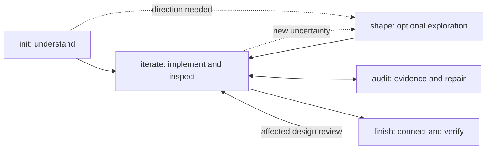

# UI Spec Studio

**Start with a goal. Review a working interface. Continue to a real product.**

[简体中文](README.zh-CN.md) · [Install](docs/INSTALL.md) · [Guide](docs/GUIDE.md) · [Design model](docs/MODEL.md) · [Release notes](CHANGELOG.md)

UI Spec Studio is a framework-neutral [Agent Skill](https://agentskills.io/specification) for coherent, multi-page UI design and implementation. The agent understands the project, chooses useful increments, researches suitable components, builds interactive specifications, inspects actual renders and connects approved designs to real behavior.

A **UI SPEC** is a runnable design reference with meaningful interactions, representative content, connected user tasks and an identifiable review scope. It can live in your current app, component stories or preview workspace.

## Install

```bash
npx skills add D1ChangGeng/UI-Spec-Studio --skill ui-spec
```

Choose your target host when useful:

```bash
npx skills add D1ChangGeng/UI-Spec-Studio --skill ui-spec -a codex
npx skills add D1ChangGeng/UI-Spec-Studio --skill ui-spec -a claude-code
npx skills add D1ChangGeng/UI-Spec-Studio --skill ui-spec -a opencode
```

For a fixed release, install from the `v1.1.0` tree:

```bash
npx skills add https://github.com/D1ChangGeng/UI-Spec-Studio/tree/v1.1.0 --skill ui-spec
```

The standard CLI needs a supported Node.js runtime and network access. The skill's core is Markdown. Optional record helpers use Python 3.10+ and its standard library. See [installation](docs/INSTALL.md) for local copies, updates and capability requirements.

## Use ordinary language

```text
Use ui-spec to design this project. I have a goal but no visual direction.
Inspect what exists, recommend a direction and build the first useful result.

Approved, continue with the next useful iteration.

This view feels unbalanced. Inspect the whole composition and fix its cause.

The selected SPEC is approved. Use ui-spec to finish the real integration.
```

The agent owns routine analysis and implementation. Your detailed references become constraints when supplied; a concise goal is enough to begin. Review actual results and give feedback in your own terms.

## Workflow



| Operation | Purpose |
|---|---|
| `init` | Establish project facts, users, constraints and a justified next increment |
| optional `shape` | Resolve important product/design uncertainty through focused analysis and representative rendering |
| `iterate` | Add, refine, merge or repair a meaningful slice; inspect it and carry accepted decisions forward |
| `audit` | Inspect a declared scope and diagnose causes; repair when authorized |
| `finish` | Reconcile, contract, sequence, connect, verify and deliver real product behavior |

Operations are intent labels, not terminal commands. Enter at the project's actual state. Audit participates in each implemented round. Shape is available when a decision needs it. Finish includes real data, authority, persistence and design regression for the architecture actually being built.

## Professional context that travels with the work

Before substantive work, the agent reads six common references together: workflow, analysis, visual principles, component sourcing, interaction/variants and verification. Integration guidance becomes required when working on real behavior. Examples and research sources remain supporting material.

This is a reading contract, not a context-management runtime. The host controls activation, tool access, retention and compaction. The skill instructs the agent to read necessary text, reuse current available material and reopen missing sources. It does not certify model understanding.

## What remains consistent

**Product reasoning:** eight lenses connect user outcomes, product facts, page responsibilities, state journeys, visual direction, components, inclusive use and evidence. The next round follows value and dependencies, rather than page count.

**Visual judgment:** readable hierarchy, stable core scale, appropriate composition occupancy, relational whitespace, optical balance, family anchors and continuous states. Compact tasks, reading surfaces and workspaces use suitable layouts; identity and expression remain project choices.

**Open sourcing:** accessible primitives, product components, effects, motion, icons, data widgets and design-only references have distinct roles. React/Vue Bits, Magic UI, Lucide, Finesse UI and other sources are candidates evaluated for actual fit, behavior, cost and license.

**Real completion:** design approval, connection, verification and release are separate scope-level facts. Reuse approved components and evolve the current project. Protected decisions belong to their trusted owners.

## Distribution and assurance

The package includes self-contained instructions, references, optional templates, local record helpers, deterministic tests and a reproducible build. CI checks supported Python/platform combinations and standard Skills CLI installation; a versioned release is published after its gates pass.

These checks establish packaging and tool behavior. Design quality is assessed through the actual product's renders and tasks. This release uses logical scenario analysis for workflow design; large comparative model evaluations are outside its release gate. See [assurance and evidence](docs/EVALUATION.md).

## Documentation

| Need | Reference |
|---|---|
| Installation and updates | [INSTALL](docs/INSTALL.md) |
| Start, continue, review and finish | [GUIDE](docs/GUIDE.md) |
| Integrated design and responsibility model | [MODEL](docs/MODEL.md) |
| Agent-facing writing standard | [WRITING](docs/WRITING.md) |
| File-by-file review and change scope | [REVIEW](docs/REVIEW.md) |
| Optional coverage records | [MANIFEST](docs/MANIFEST.md) |
| Sources and design rationale | [RESEARCH](docs/RESEARCH.md) |
| Tests and release assurance | [EVALUATION](docs/EVALUATION.md) |
| Maintainer release procedure | [PUBLISHING](docs/PUBLISHING.md) |

## Contribute

```bash
python tools/validate_package.py
python -m unittest discover -s tests -v
python tools/package.py
```

See [contribution guidance](CONTRIBUTING.md) and [security policy](SECURITY.md). Research references include [Emil Kowalski](https://github.com/emilkowalski/skills), [Impeccable](https://github.com/pbakaus/impeccable) and [Taste Skill](https://github.com/Leonxlnx/taste-skill). The lifecycle, text and tools here are independently maintained. [MIT](LICENSE).
