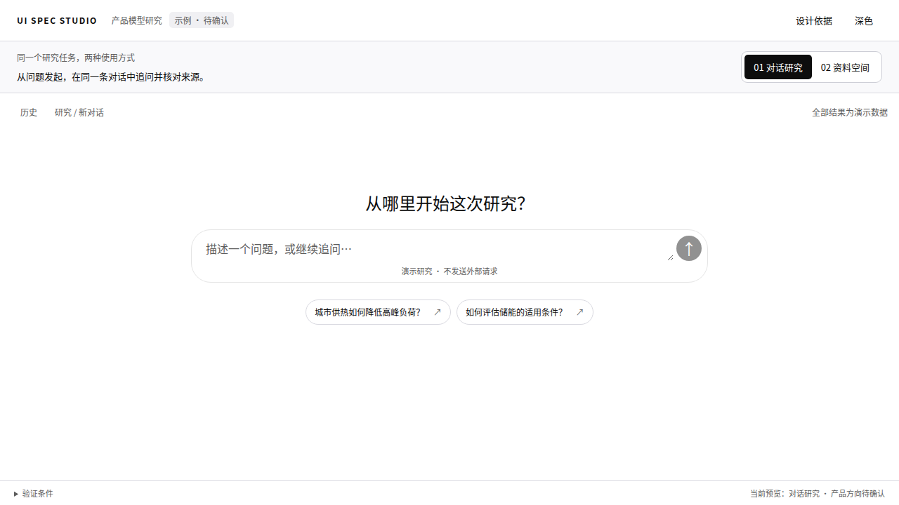

# UI Spec Studio

**以成熟设计成果为起点的专业设计工程实践。**

<picture>
  <source media="(max-width: 600px) and (prefers-color-scheme: dark)" srcset="docs/assets/studio-compact-dark.svg">
  <source media="(max-width: 600px)" srcset="docs/assets/studio-compact-light.svg">
  <source media="(prefers-color-scheme: dark)" srcset="docs/assets/studio-dark.svg">
  
</picture>

[English](README.md) · [使用指南](docs/GUIDE.md) · [技能正文](skills/ui-spec/SKILL.md) · [正式版本](https://github.com/D1ChangGeng/UI-Spec-Studio/releases)

从一个产品目标出发，形成协调、可审阅的界面，再把批准的体验接入真实使用。UI Spec Studio 是通用的 [Agent Skill](https://agentskills.io/specification)，适用于产品页面、文档、README、图表及其他屏幕表达。

## 一条命令开始

```bash
npx skills add D1ChangGeng/UI-Spec-Studio --skill ui-spec
```

然后向编程 Agent 发出任务：

```text
使用 ui-spec，理解当前项目并完成第一轮有价值的 UI SPEC。
我只有产品目标，还没有视觉方向。请推荐合适的设计并展示实际结果。
```

你可以提供详细参考，也可以只有一个目标。Agent 负责形成方向、选择下一项有价值的工作、实现并观察实际效果，再根据你的反馈继续。

已有批准的设计时，可以直接要求执行 `finish`，完成真实接线。[安装与宿主选项 →](docs/INSTALL.md)

## 从成熟设计成果建立起点

设计理论提供判断能力，UI 资源提供可研究、可比较、可复用的实际对象。
新页面优先寻找最高适当复用层级：完整页面或设计系统、功能区块，再到组件与具体效果。
继承有价值的层级、比例、排版节奏和交互关系，将自主创造集中用于产品差异、适配、整合与体验优化。

产品分析、实际搜索与浏览、专业比较、选型、实现和验证持续联动；新的资源发现也可以完善初始方案。
局部改进则继承已确认的整体基础，在适当范围内继续工作。



[查看整体设计关系的来源与适配](examples/product-intent/FOUNDATION.md)。

## 先确认用户期待怎样使用产品

从第一项操作、主要工作对象和持续任务判断产品交互模型，再确定页面结构。
成熟产品范式与具体 UI 工程资源并行研究；功能资产继续继承，视觉候选按目标品质评估。
对仍有显著分歧的重要方向，Agent 提供推荐与少量有意义的选项，帮助用户确认。

每份实质性 SPEC 与设计资源记录一同交付：选择了什么、为什么、如何改造、实际出现在哪里。
[设计决策指南](docs/DESIGN-DECISIONS.md) · [可运行的双模型样例](examples/product-intent/README.md)

## 设计是一组相互连接的判断

**意义 → 概念 → 表现形式 → 视觉语言 → 实现 → 证据。**

在选择卡片、表格、图解或动效之前，先明确用户需要理解什么。形成属于当前产品的设计概念，让重要关系在代码中可以控制，并通过实际结果判断效果。

| 能力 | Agent 需要解决的问题 |
|---|---|
| **理解与观察** | 用户任务、内容意义、页面职责，以及行动前需要的信息 |
| **构思与表达** | 有依据的方向、合适的表现形式、排版、色彩、空间、图像与注意力顺序 |
| **制作与控制** | 用组件、素材与可编辑参数，将设计准确带入实际交付媒介 |
| **判断与改进** | 观察整体意义、结构关系和细节，定位原因、修复并验证真实任务 |

[阅读专业能力模型](docs/PROFESSIONAL-MODEL.md) · [查看条件明确的技法案例](skills/ui-spec/references/patterns.md)

## 连续推进，而不是反复重新指导

**init（理解）→ iterate（迭代）→ finish（接线）**

重要方向尚未明确时使用可选的 **shape（探索与收敛）**；需要系统检查时使用 **audit（审查）**。它们是工作意图，使用自然语言即可。

**开始。** Agent 读取产品与已有实现，继承已确认的决定，选择下一项有价值的结果。

**继续。** 只需说“本轮通过，继续”。每轮可以开发页面、补齐用户路径、完善组件族或修复共享问题。Agent 承担常规分析、组件调研和实际渲染检查。

**接线。** Finish 对照批准设计，接入真实内容、服务、权限和持久化，并同时检查意义、结构、视觉与行为时序的保真。静态作品按实际发布边界完成交付。

```text
这个页面感觉有些偏低。请观察完整构图，分析原因并修复。

继承已确认的方向，继续推进下一项最有价值的用户任务。

当前审阅范围已经通过。接入真实产品，并验证设计表现与实际业务结果。
```

## 完整、持续可用的专业基础

开始实质性工作前，Agent **完整读取六份通用参考**：

[工作流](skills/ui-spec/references/workflow.md) · [分析视角](skills/ui-spec/references/analysis.md) · [视觉原则](skills/ui-spec/references/principles.md) · [组件与媒介](skills/ui-spec/references/component-sourcing.md) · [交互与变体](skills/ui-spec/references/interaction-and-variants.md) · [验证方法](skills/ui-spec/references/verification.md)

涉及真实业务时，[接线参考](skills/ui-spec/references/integration.md)成为必读；技法与实例按任务需要补充。当前上下文中完整且有效的材料可以继续使用。

Skill 提供专业方法与读取契约；宿主负责激活、工具、执行和上下文管理。常规设计判断由 Agent 承担，重要外部承诺遵循用户授权。

## 主动利用整个 UI 生态

**发现 → 评估 → 适配 → 集成 → 验证 → 沉淀经验。**

Agent 主动寻找有价值的起点：项目已有组件、原生能力与外部优秀实现。既为明确需求寻找可靠方案，也通过资源探索发现更合适的表达。读取具体演示、源码变体和配置，再结合行为、设计适配、授权与总成本选择复用方式。

可以直接采用、扩展改造、组合能力或借鉴技法。字体、空间、状态与动效最终融入同一个产品；实际渲染和任务操作确认组合后的品质。

[浏览 37 个资源候选](skills/ui-spec/references/resource-catalog.md) · [阅读通用方法](skills/ui-spec/references/component-sourcing.md) · [使用目录与采用流程](docs/RESOURCE-REUSE.md)

目录保留来源日期和证据范围，并说明七类信息获取机制。可选的本地工具支持按需求、技术范围和交付形态检索。适配且已批准的选择持续复用，新的设计需求由 Agent 主动研究和推进。

## 根据任务选择表达方式

复用当前工程，选择真正合适的手段：原生控件、组件体系、图标、实际图像、原创图形、数据可视化或专项工具。React/Vue Bits、Magic UI、Lucide 等是开放候选，按实际适配、交互、性能与授权选型。

研究工作台、单任务表单和阅读型文档采用不同构图。共同原则支撑质量，产品内容与批准的需求决定风格。

### 这份 README 本身就是一个案例

阅读路径依次回答用途、安装、首次使用、专业方法和验证依据。关键信息保留为原生文字；编辑式视觉插图具有可编辑源码、明暗双版和独立窄屏构图。[查看设计说明与验证条件。](docs/design/README-SPEC.md)

## 安装到实际工作环境

```bash
# 当前项目，指定 Codex
npx skills add D1ChangGeng/UI-Spec-Studio --skill ui-spec -a codex

# 固定版本
npx skills add https://github.com/D1ChangGeng/UI-Spec-Studio/tree/v1.4.0 --skill ui-spec
```

安装测试也覆盖 Claude Code 和 OpenCode 目标。核心内容是 Markdown；可选记录工具使用 Python 3.10+ 标准库。[离线安装与更新](docs/INSTALL.md)。

## 查看实际证据

发行流水线检查包结构、本地引用、辅助工具、可复现构建与标准安装。发布检查覆盖双语 README、生成素材及浏览器呈现。Release 提供完整源码、独立 Skill 和校验和。

这些证据对应实际执行的检查。设计质量与真实接线效果，仍在具体项目中通过视觉和任务验证。[保证范围](docs/EVALUATION.md) · [CI 记录](https://github.com/D1ChangGeng/UI-Spec-Studio/actions/workflows/validate.yml) · [版本变更](CHANGELOG.md)

<details>
<summary><strong>维护者入口：模型、写作与发布</strong></summary>

[完整理解模型](docs/MODEL.md) · [写作标准](docs/WRITING.md) · [v1.4 审查](docs/REVIEW-v1.4.0.md) · [研究来源](docs/RESEARCH.md) · [覆盖记录](docs/MANIFEST.md) · [发布流程](docs/PUBLISHING.md)

```bash
python tools/validate_package.py
python tools/readme_art.py --check
python tools/catalog_docs.py --check
python -m unittest discover -s tests -v
python tools/package.py
```

另见[贡献指南](CONTRIBUTING.md)与[安全政策](SECURITY.md)。

</details>

独立维护专业方法与工具，并列出[参考出处](skills/ui-spec/references/sources.md)。采用 [MIT 许可证](LICENSE)。
