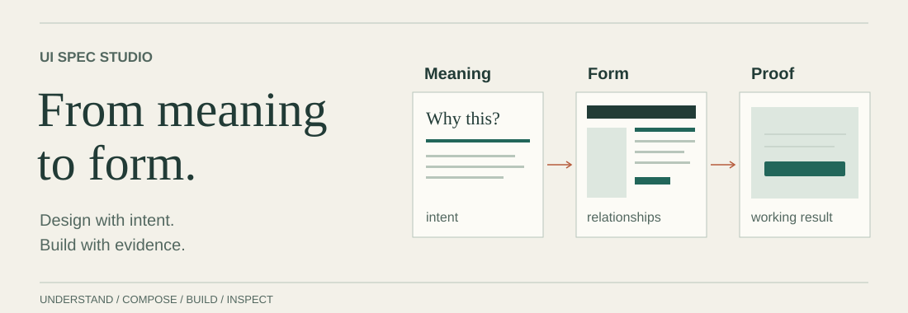

# UI Spec Studio

**以优秀的成熟成果为起点，设计真正属于当前产品的界面。**

<picture>
  <source media="(max-width: 600px) and (prefers-color-scheme: dark)" srcset="docs/assets/studio-compact-dark.svg">
  <source media="(max-width: 600px)" srcset="docs/assets/studio-compact-light.svg">
  <source media="(prefers-color-scheme: dark)" srcset="docs/assets/studio-dark.svg">
  
</picture>

[English](README.md) · [使用指南](docs/GUIDE.md) · [Skill 源码](skills/ui-spec/SKILL.md) · [正式版本](https://github.com/D1ChangGeng/UI-Spec-Studio/releases)

适用于**应用界面、README、文档、图表、演示文稿**等屏幕视觉作品的通用 [Agent Skill](https://agentskills.io/specification)。理解用户期待的体验，深入研究真实证据，比较并采用成熟成果，在实际使用中检验品质。

## 在项目中直接开始

```bash
npx skills add D1ChangGeng/UI-Spec-Studio --skill ui-spec
```

随后向编程 Agent 说明目标即可，设计方向可以由 Agent 主动研究：

```text
使用 ui-spec，理解当前项目、目标用户及其期待的体验。
研究重要问题，比较成熟设计参照与可采用的实现，
完成第一份可审阅的 SPEC，展示实际结果和关键证据。
```

审阅通过后，只需说 **「本轮通过，继续」**，Agent 就会推进下一项有价值的工作；使用 **「ui-spec: finish」**，则会将已确认的设计接入真实内容、功能或作品的发布环境。[安装与宿主选项](docs/INSTALL.md) · [多轮使用指南](docs/GUIDE.md)

## 先理解体验，再选择设计

「像某个产品」可能指熟悉的工作方式、信息组织、视觉气质或交互细节。Agent 先形成可修正的理解，分别研究当前用户的明确意图、相关用户经验与参考产品的真实表现。

研究围绕**任务、页面、状态及其关系**展开。产品资料与用户材料解释含义，真实界面揭示视觉品质，实际操作与连续画面呈现时间体验。参考版本、平台和使用条件由目标体验决定，新的发现可以改变产品模型、搜索方向或资源选择。

[体验研究与证据规划](docs/EXPERIENCE-RESEARCH.md) · [产品对齐方法](docs/PRODUCT-ALIGNMENT.md)

## 视觉素材与界面共同设计

品牌符号、图标、字体与字形、插画、图片、空间化图形和动态资产共同形成产品表达。
Agent 研究成熟素材、判断制作路径、维护可编辑母版与交付变体，并在实际界面中检查视觉、加载与降级状态。
素材也可以反向决定构图与排版。[资产工程方法](docs/VISUAL-ASSETS.md) · [浏览器验收样例](examples/asset-review/README.md)

## 让成熟实现承接产品品质

**品质目标 → 成熟实现 → 局部试装 → 针对性适配 → 完整体验验证。**

**Product UI Experience Alignment**（产品 UI 体验对齐）以符合当前用户、任务、内容和运行条件的设计成熟度为目标。指定产品提供探索入口，开放需求由 Agent 主动建立参照。研究提炼构图、排版、组件细节、状态反馈与连续交互中值得继承的关系，再形成当前产品自己的表达。

**成熟实现是通用 UI 的默认来源。** 参照研究与资源选型持续配对，从整页、设计系统、布局、区块、组件、素材或动效中选择最高适当层级。重要候选先查看原始演示，再用项目的真实内容、字体、主题与状态局部试装，通过后扩大集成。配置、组合和二次开发保留使其值得采用的关系，定制解决已确认的具体缺口。

整合后的界面与连续任务再次接受审阅。采用记录说明实际由哪个实现承担目标品质、进行了哪些改动、验证到什么程度，并区分研究来源与最终采用。[产品对齐与主动探索](docs/PRODUCT-ALIGNMENT.md) · [资源复用指南](docs/RESOURCE-REUSE.md)

[37 项带来源记录的资源线索](skills/ui-spec/references/resource-catalog.md) · [设计决策记录](docs/DESIGN-DECISIONS.md)

## 让熟悉的任务拥有独立的视觉语言

**Art Direction**（艺术指导）围绕产品气质协调题材、字形、构图、材质与动态表达。专业工具同样可以拥有鲜明艺术性。明确提出的审美目标与任务清晰、状态准确、使用可靠共同构成交付要求。

**Expressive Contrast**（表达性反差）同时研究功能体验、跨领域表达与实际实现资源，通过完成度相称的预览比较实质方向，再将选择转为按角色组织的视觉系统。成熟资源与针对性素材制作，让视觉语言进入填入内容后的输入、导航、结果与连续工作。

**体验成立性**与**表达完成度**分别审阅。源设计保真保护已采用或确认的细节，感知评估判断真实呈现；作者时间轴支持可重复的画面比较，真实产品另需实际操作与运行证据。[艺术指导与表达性设计](docs/ART-DIRECTION.md)

## 持续探索，让重要选择有据可依

**证据驱动探索**连接研究问题、搜索、实际观察、候选比较与下一项问题。投入由设计影响、不确定性和潜在改进价值决定。一个决定产品气质的字体、背景或交互可以获得跨大量独立来源的持续研究；已有可靠依据的常规组件可以较快进入验证。

比较具有实质差异的候选，主动寻找可能改变初始选择的方案。沿着新线索播放、滚动、切换状态、研究实现并局部试装。访问不完整时继续寻找合理的替代证据，必要时请求具体取材协助。实际观察、资料描述、专业判断与剩余缺口分别保留依据。

**Human-centered Visual Inspection & Perceptual Design Analysis**（面向人类视觉感知的观察与设计分析）将真实观看转为专业判断。从正常尺度下的整体印象与注意力层级开始，深入构图、功能区域及重要组件或素材细节，再回到完整界面。按问题选择排版、光学平衡、色彩、材质和动效等维度，理解品质如何形成，并据此选择能够承接这些关系的成熟实现。

观察覆盖**单个画面、连续变化与完整使用旅程**。时序视觉观察跟随触发、首次反馈、过渡与稳定结果；先以正常速度理解体验，再通过有价值的细节观察与重放分析原因，最后回到完整过程判断。行为与设计影响决定观察深度。

从覆盖、细节、时间、相关性和可靠性判断证据。可能改变选择的缺口继续研究；已有依据的方向进入试装；关键适配成立后扩大实现。搜索次数和用时描述投入，证据实际回答了什么决定下一步。

[研究方法](docs/EXPERIENCE-RESEARCH.md) · [视觉观察](docs/VISUAL-INSPECTION.md) · [时序样例](examples/temporal-review/README.md)

## 文字内容也是完整的 UI 设计对象

Agent 需要判断**用户应该理解什么、信息由哪里承担、怎样自然表达，以及文字如何在页面中呈现**。内容设计与 UX Writing 将真实产品信息、用户熟悉的术语、操作文案、动态反馈、本地化和字体排版与页面结构、视觉素材一同设计。文字变化可以推动布局调整，实际渲染也可以反过来优化内容。

[内容设计指南](docs/CONTENT-DESIGN.md) · [双语可运行示例](examples/content-review/README.md)

## 面向真实使用与持续运营设计

产品模型、视觉素材、内容、布局、组件状态和动效共同服务于**流畅的操作与可持续维护的内容**。Agent 从连续操作追踪输入、可用结果和权威完成，根据实际收益与有效性选择提前准备、并发和缓存；保持对象变化与滚动的位置连续性，再围绕真实维护任务设计共享内容、单项覆盖和批量恢复。

[完整体验模型](docs/EXPERIENCE-QUALITY.md) · [运行与运营接线](skills/ui-spec/references/integration.md) · [验证方法](skills/ui-spec/references/verification.md)

## 一套方法，适用于不同视觉媒介

通用原则提供专业判断；**具体媒介决定表现形式与最终验收方式**。

| 设计对象 | 用户首先需要完成的事 | SPEC 应当确认的结果 |
|---|---|---|
| **产品界面** | 发起、完成并继续一项任务 | 真实的交互状态、稳定布局、操作路径与业务结果 |
| **README 与文档** | 理解工具、复制命令、找到下一步说明 | 阅读顺序、原生文字与链接、宿主渲染、主题图片和窄屏表现 |
| **图解与数据表达** | 追踪关系、解读数据或比较方案 | 正确的关系语义、可读标注、数据映射与可访问的替代表达 |
| **演示文稿与视觉媒体** | 随空间和时间顺序理解内容 | 清晰的注意力节奏、可编辑素材及实际展示/播放条件下的验证 |

[专业能力模型](docs/PROFESSIONAL-MODEL.md)与[条件明确的设计技法](skills/ui-spec/references/patterns.md)进一步连接排版、构图、色彩、素材、交互与时间表达。

## 这份 README 本身就是一份 UI SPEC

仓库首页首先是一种**阅读与发布界面**。新读者需要快速理解 Skill 的作用、判断是否符合自己的任务，然后完成第一次使用。视觉表达服务于这条阅读路径，核心信息依然由 GitHub 原生 Markdown 承载。

本次复用侧重**信息组织和发布媒介的成熟设计关系**。完整的候选比较与采用范围保存在 [README 设计说明](docs/design/README-SPEC.md)：

- **[Vercel Skills CLI](https://github.com/vercel-labs/skills/blob/main/README.md) — 先让读者开始行动。** 借鉴其清晰的产品用途、快速安装与深入文档路径，将首次命令和 Agent 指令前置。
- **[Typst](https://github.com/typst/typst/blob/main/README.md) — 用视觉例子解释方法。** 通过可编辑插图说明「研究 → 选择 → 实现」，同时以原生正文保留完整说明。
- **[GitHub Markdown 规范](https://docs.github.com/en/get-started/writing-on-github/getting-started-with-writing-and-formatting-on-github/quickstart-for-writing-on-github) — 充分利用宿主能力。** 标题、链接和代码块使用原生结构，插图分别适配明暗主题及宽窄视口。
- **原有 UI Spec Studio 视觉体系 — 延续统一的设计语言。** 保留克制的主题色与编辑式排版，将表达重点调整为成熟成果驱动的设计过程。

这里继承的是成熟的设计方法，插图与 Markdown 内容由本仓库维护。[设计记录](docs/design/README-SPEC.md)同时说明实现位置、渲染核查与证据边界。

另有一份[研究产品设计案例](examples/product-intent/README.md)，展示应用 UI 中的整页设计迁移，并保留[采用来源与继承关系](examples/product-intent/FOUNDATION.md)。

## 从设计推进到真实结果

主线是 `init → iterate → finish`。可选 **shape** 用于收敛重要设计方向，**audit** 可在任何阶段检查质量与覆盖范围。这些是工作意图，使用自然语言即可启动。

每轮由 Agent 选择有价值、便于审阅的范围，完成实现与实际检查。确认后的设计可以进入真实产品接线，也可以完成文档、图表或演示内容本身的发布。既有决策持续继承，来源证据、渲染观察与用户批准分别记录。

进入实质工作前，Agent 会**完整读取八份通用参考**：[工作流](skills/ui-spec/references/workflow.md)、[分析视角](skills/ui-spec/references/analysis.md)、[视觉原则](skills/ui-spec/references/principles.md)、[资源发现](skills/ui-spec/references/component-sourcing.md)、[交互与变体](skills/ui-spec/references/interaction-and-variants.md)、[验证方法](skills/ui-spec/references/verification.md)、[视觉素材与资产工程](skills/ui-spec/references/visual-assets.md)、[内容设计与 UX Writing](skills/ui-spec/references/content-design.md)。真实业务接线另需[集成参考](skills/ui-spec/references/integration.md)。Skill 负责专业方法与读取契约，宿主负责工具、执行和上下文管理。

## 安装、验证与维护

```bash
# 将 Skill 安装到当前项目的 Codex
npx skills add D1ChangGeng/UI-Spec-Studio --skill ui-spec -a codex

# 固定正式发布版本
npx skills add https://github.com/D1ChangGeng/UI-Spec-Studio/tree/v1.12.1 --skill ui-spec
```

安装检查也覆盖 Claude Code 和 OpenCode。核心参考以 Markdown 提供；可选记录工具使用 Python 3.10+ 标准库。[离线安装与更新](docs/INSTALL.md)。

工程检查覆盖文件引用、辅助工具、安装路径及可复现打包；发布检查覆盖双语 README、响应式图片和实际页面渲染。具体产品的设计品质与业务接线效果由该项目的实际验证决定。[验证与保证范围](docs/EVALUATION.md) · [CI](https://github.com/D1ChangGeng/UI-Spec-Studio/actions/workflows/validate.yml) · [版本记录](CHANGELOG.md)

<details>
<summary><strong>维护者资料与本地检查</strong></summary>

[完整理解模型](docs/MODEL.md) · [写作标准](docs/WRITING.md) · [研究来源](docs/RESEARCH.md) · [README 设计记录](docs/design/README-SPEC.md) · [发布流程](docs/PUBLISHING.md) · [贡献指南](CONTRIBUTING.md) · [安全说明](SECURITY.md)

```bash
python tools/validate_package.py
python tools/readme_art.py --check
python tools/catalog_docs.py --check
python -m unittest discover -s tests -v
python tools/package.py
```

</details>

[MIT 许可证](LICENSE) · [设计与研究来源说明](skills/ui-spec/references/sources.md)
