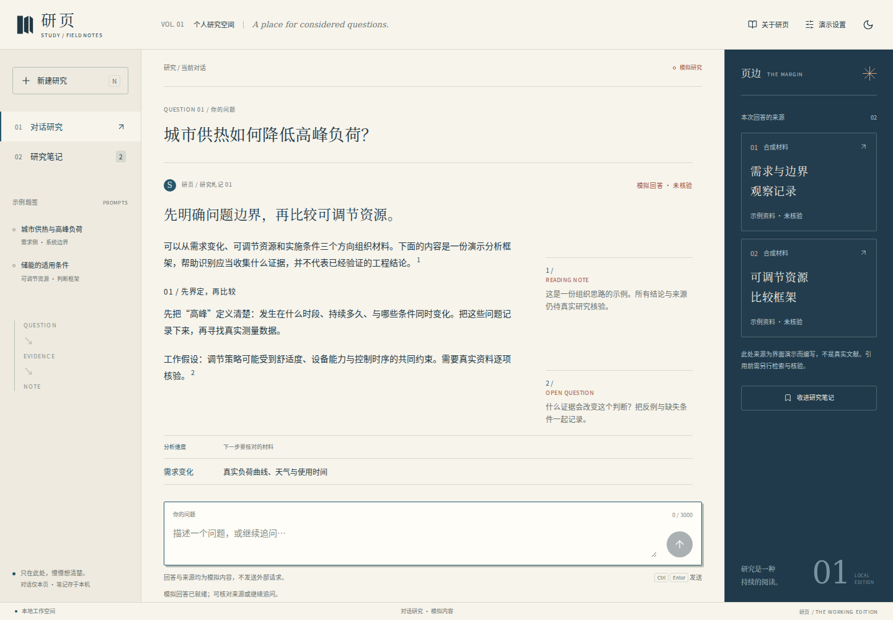
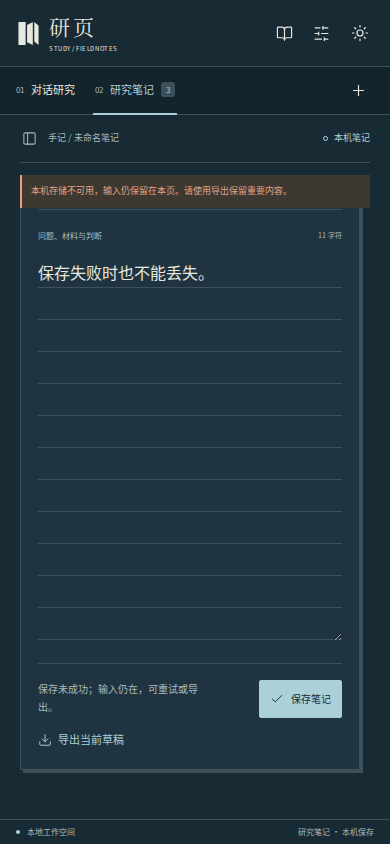
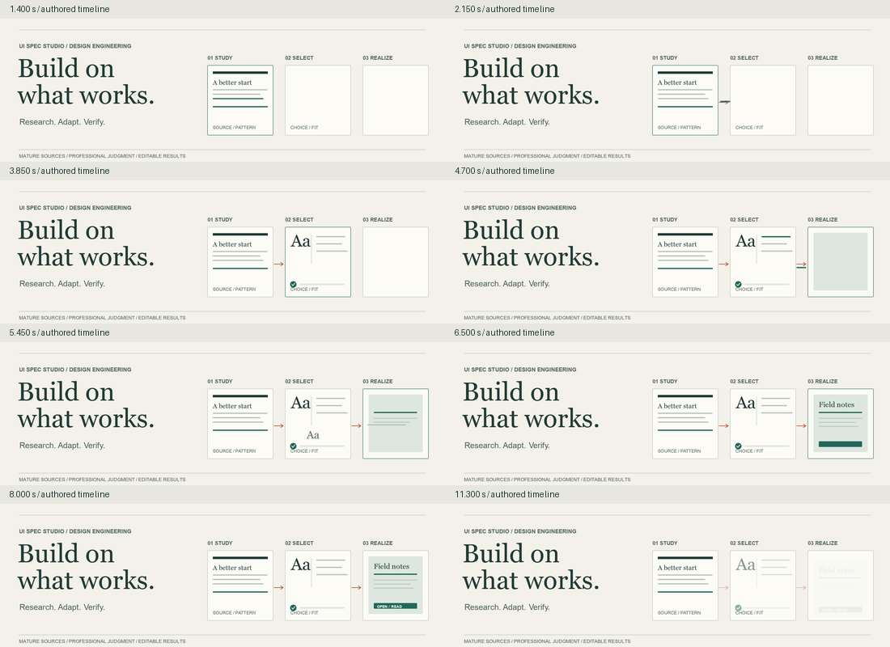
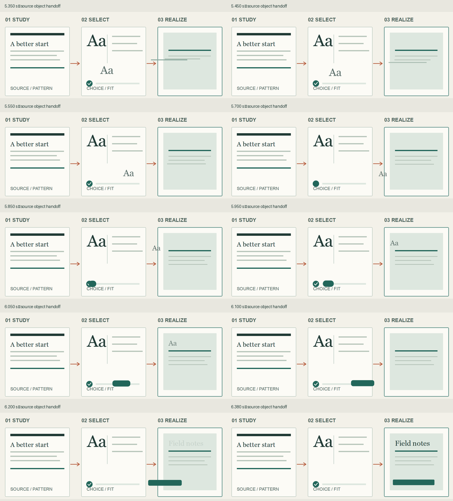

# UI Spec Studio 1.11.0 review

## Scope and accepted behavior

This release connects Art Direction, Visual System, Asset Engineering, Motion
Storytelling, Source Fidelity and Perceptual Quality to the existing product
alignment and mature-adoption method. It also implements Expressive Contrast:
familiar task relationships can support independent, strongly artistic expression
inside professional software and its populated working states.

| Accepted requirement | Responsible implementation |
|---|---|
| Treat explicit aesthetic goals as delivery requirements | Analysis and principles distinguish task requirements, explicit aesthetic requirements and revisable conventions; professional-product categories do not determine visual restraint |
| Inherit familiar relationships while changing expression | Principles allows navigation, composition, typography, shape, material and motion to develop while retaining clear task meaning and observable quality |
| Research function, expression and implementation together | Sourcing connects functional references, cross-domain expressive references and actual mature resources; sources can serve several roles |
| Compare consequential directions fairly | Analysis asks for materially different, similarly resolved visual candidates when a decision needs user choice; established direction and delegated work can proceed |
| Establish a coherent visual system | Principles turns chosen direction into roles, relationships, tokens and purposeful exceptions; actual rendering determines optical quality |
| Use high-quality assets and specialist production | Visual-assets distinguishes reference, concept and product asset, with source, rights, export, runtime cost and actual placement evidence |
| Give movement a meaningful role | Interaction connects signals, grouping, object relations and result formation to task semantics, attention and truthful state |
| Keep fidelity and perceptual quality distinct | Verification identifies the selected/approved target and comparison conditions; image differences diagnose implementation, while actual viewing judges perceived quality |
| Match evidence to product, demonstration or authored work | Analysis, interaction and verification separate actual behavior from staged presentation; controlled timelines and natural-time runtime evidence have different scope |
| Verify experience and expression independently | Verification and integration preserve separate findings, examine populated core work and repair concrete failures while retaining the confirmed direction |
| Keep content truthful | Content-design requires confirmed business claims and clearly identified conceptual fixtures |

The [art-direction guide](ART-DIRECTION.md) explains the complete method. Public
product, resource, experience and visual guides follow the same responsibilities.
Optional templates help record decisions; they do not add a required process.
The existing `init → iterate → finish` path, optional shape, eight common references,
mature-implementation default and host responsibility boundaries remain.

## Source consistency and context budget

The maintainer read the entry, all eight common references and integration in full.
A separate source auditor read those current files, changed patterns and templates,
then compared additions and deletions against v1.10.0 and the maintainer contract.
It found no required correction, lost invariant or blocking contradiction. The
[source audit](evidence/v1.11.0/method-source-audit.json) records its exact scope;
it is not an application-output or visual-quality assessment.

The eight common references total **145,472 bytes**, within the unchanged
147,456-byte limit. SKILL is **144 lines**. No new required runtime dependency,
capture quota, aesthetic score, workflow stage or approval checkpoint is added.
These measurements describe packaging and reading cost, not model comprehension.

## Independent application setup

Two fresh-context applications received an ordinary task, the frozen skill and
raw input. They received no maintainer diagnosis, anticipated repair, earlier
review or sibling result. The workspace input consists of the five source/notice
files from `examples/product-intent/` at v1.10.0. The authored-film input is the
unaltered `docs/assets/studio-light.svg` with the repository license.

The whole **29-file skill** was frozen before either application. The SHA-256 of
its path-sorted compact JSON hash map is
`b1f243ec6f8fbbd8b64d3255984821d597c319a3853a51c32372a6b928c5b730`.
The [frozen identity](evidence/v1.11.0/frozen-skill-identity.json) records each file.
Available browser binaries and optional font configuration were supplied as neutral
execution context. Applications selected their own references, resources, direction,
implementation and inspection strategy.

These are bounded applications to synthetic local work, not a controlled model
comparison, real-audience research or certification across product categories.
Captures, actual visual inspection, source analysis and interaction assertions
retain separate scope.

### Expressive research workspace

The ordinary task asked for a strong, memorable artistic direction that survives
populated questions, results and notes, while preserving supported actions,
truthful simulation labels, Chinese/mixed-language content, local note recovery,
themes and narrow/wide use. Direction and implementation were delegated.

The application selected **研页 Study**, an editorial research folio. A warm reading
page and dark blue evidence margin, serif question/thesis/note headings, numbered
source relationships and a ruled writing surface form the identity. The same
language appears in the actual answer, note collection, editable draft and source
dialog. This is an agent-selected proposal; user preference and owner acceptance
remain separate.

The author viewed the public assistant-ui ChatGPT example's empty/composer/sidebar
relationship and operated its sidebar. It also viewed and scrolled Tufte CSS's
reading/margin-note example. These observations have different adoption outcomes:

| Source or capability | Actual current-product responsibility |
|---|---|
| Existing assistant-ui-derived application relationships | Design inheritance: shared composer, empty/active states, bounded reading and exclusive send/stop; no assistant-ui React runtime is installed |
| Tufte CSS | Actual scoped float/clear/negative-margin sidenote rules in answer reading; narrow annotations become always-visible inline content |
| Native HTML | Form, textarea, input, radio, select and dialog mechanisms; custom code coordinates navigation, cancellation, focus return and storage |
| Noto Sans SC 2.004 / Serif SC 2.003 | Actual locally served glyph assets, renamed UI subsets and full SC fallbacks, with OFL notices |
| Lucide 0.468.0 | Seventeen actual pinned SVGs combined into the functional icon sprite |
| Authored work | Folio frame, semantic palette, source-to-note composition, brand mark and local note/draft/backup adapter |

The inherited Radix token file remains unchanged as provenance but no longer owns
the visible palette. The author identifies the studied candidates' gaps and the
custom integration explicitly. This is not adoption of a complete component-library
page. Its first local trial was an assembled layout with real fonts, content and
states; a separate component-only prototype was not run. Resource and trial scope
are recorded as performed, without treating a reference visit or font/icon import
as proof of full structural reuse.

Actual trial viewing found missing CJK fallback in small labels, a colliding
decorative caption, transient low-contrast text during theme changes, a malformed
table that reordered answer content, and an answer fade repeating on return from
notes. The author repaired those causes while retaining the folio direction. It
also refined title focus and corrected note-state language.

The [narrow research view](evidence/v1.11.0/workspace-research-narrow.png) keeps
annotations inline. The [dark view](evidence/v1.11.0/workspace-research-dark.png),
[note collection](evidence/v1.11.0/workspace-collection.png) and
[recovered mixed-language draft](evidence/v1.11.0/workspace-recovered-draft.png)
show the expression in populated core work.

The maintainer independently opened nine representative stills. In the narrow
storage-failure frame, the feedback instructed export while only Save remained
visible; the header Export had scrolled away. A review-directed repair places
**导出当前草稿** beside the failure feedback. The author operated that action and
verified the downloaded draft text. The maintainer opened the repaired frame and
the changed recovered-draft frame; the other seven reviewed images remain
byte-identical.

The [preceding failure frame](evidence/v1.11.0/workspace-storage-before.png)
preserves the observed issue. The successful save design remains intact. Two
existing test cases were also strengthened to assert the actual stored values:
backup recovery preserves the corrupt primary input, and legacy import preserves
the original serialized key. These are identified as review-directed refinements.

The final run passed **19 checks** and captured 30 images using Playwright 1.62.1
with Chromium 134.0.6998.35. The checks cover four width/theme routes, stop/retry,
draft preservation across completion and navigation, long mixed-language content,
source-to-note provenance, reload/save/restore/export, independent notes, backup
and legacy recovery, storage denial, and 320×568 reduced-motion use. There were no
observed page-error events in the monitored contexts. Assertions, actually viewed
frames and synthetic fault injection remain distinguishable in the record.

The final standard variants load two UI font subsets totaling about **309 KB**.
Full SC fallbacks still total about **14.5 MB** and may load for other characters;
the initial-font result does not characterize arbitrary content or device/network
performance. Answers and sources remain clearly labeled synthetic fixtures.
Notes use real browser-local persistence; conversations remain per-page state.
Real research integration, handset keyboards, other browser engines, assistive
technology and human comprehension/preference were not established. The ordered
episode captures do not establish continuously observed motion or frame delivery.

### Faithful authored motion

The second ordinary task requested a polished twelve-second study → select →
realize loop from the supplied 1100×355 SVG, preserving wording, identity,
typography, proportions and detail, with a faithful settled view, meaningful
movement, readable hold, loop join, editable implementation and local controls.
It was explicitly authored presentation work with no product backend claim.

The complete original SVG supplies the visual foundation. GSAP 3.15.0 supplies
the timeline, easing, SVG transforms/attributes, seeking and repetition; native
controls supply playback and navigation. Playwright and FFmpeg supply the local
rendering/encoding route. The author inspected the original hosted GSAP timeline
demonstration and the local source trial. GSAP's runtime keeps its own notice and
standard-license boundary; the supplied artwork keeps its MIT notice.

The title, card frames and phase labels remain stable. A researched rule moves
into the selection; selected type, rules and action move into the realized page.
The complete source holds from **6.85 to 10.90 seconds**. The reset and beginning
share a quiet study state. The delivered MP4 is **2200×710, 60 fps, 720 frames,
12 seconds**, accompanied by a WebM version and a local editable player.

The [MP4](evidence/v1.11.0/studio-film.mp4) and
[settled poster](evidence/v1.11.0/film-poster.png) preserve different evidence roles.
The unchanged SVG originally requests Georgia and Arial. Production used those
faces locally, then baked complete phrases into graphic output at 2× while
retaining editable source wording and vector geometry. Font software is not
included in the delivered film assets. This fixed-media technique is not presented
as accessible live application text; the preview separately provides its transcript.

An initial typography-edge discrepancy was repaired through whole-phrase source
pixels. Under the declared Chromium 134, 1100×355 CSS-pixel, DPR 2 conditions,
the lossless 8-second poster and original-source render are **byte-identical**.
This is a comparison before video encoding, not a claim that compressed video
matches the source pixel for pixel or that image equality proves aesthetic quality.

Independent output review then found that the moving **Aa** crossed the selection
rules and briefly overlapped the arriving **Field notes** title. The reviewer and
maintainer actually opened the relevant detail. A focused, review-directed repair
routes the type through the lower open area, clears it by 6.10 seconds, and reveals
the title from 6.12–6.38 seconds. The settled hold and loop remain unchanged.

The [initial detail](evidence/v1.11.0/film-transfer-before.png) preserves the
double-letter finding. The independent reviewer inspected 16 repaired authored
samples and 12 independently decoded final MP4 samples. Of the original 32 authored
samples, 27 remained byte-identical; all five changed samples were re-inspected.
No blocking visual finding remained within that sampled scope. The maintainer
also viewed the repaired handoff sheet.

All **nine browser/timeline checks** passed: duration, raw loop endpoints and last
sample, fourteen retained source phrases, live controls, natural-clock loop
advancement, encoded WebM playback, reduced-motion/narrow preview and monitored
console behavior. The narrow preview starts paused at the settled frame under
reduced motion. Browser playback was established for WebM, with MP4 as fallback;
the record does not claim MP4 playback in this Chromium build. Independent full
decoding found 720 frames in each codec with matching decoded YUV frame hashes.
Neither metadata nor successful browser playback is a continuous visual judgment.

Source/poster/hold and raw seam identities remain exact after the repair. Dense
controlled samples support the clean type handoff; actually opened ordered samples
support the recorded spatial progression. No reviewer claims normal-speed
continuous visual playback, real-device frame delivery, user comprehension or
owner approval. The fixed wide artwork's small lettering also retains its intended
viewing-scale limit on a narrow phone preview.

Both applications' input identities, actual adoption, final source identities,
executed checks, author-viewing scope, independent reviews and representative
artifact hashes are in the [application evidence](evidence/v1.11.0/application-review.json).
Review-directed iterations remain distinguishable from the initial applications.
The application dependencies do not become installed skill dependencies.

A separate [final evidence audit](evidence/v1.11.0/release-evidence-audit.json)
cross-checked the identities, counts, embedded application records and local links
without finding a required correction. It retained one optional label advisory:
the raw film check named “Last encoded sample / first sample” compares authored
PNG inputs at the corresponding times. Its detailed record and the conclusions
above preserve the uncompressed-versus-encoded distinction. The historical
execution record remains unaltered.

## README publication review

Native GitHub Markdown and the established responsive artwork continue to carry
the reading experience. The new section connects independent expression, mature
resources and separate experience/expression assessment to an accessible detailed
guide. The installation entry and first-use path retain their placement.

The local Markdown-It/Chromium approximation rendered English/Chinese, light/dark,
at 390×844, 768×1024 and 1440×1000. A separate reviewer actually opened all **24
viewport/full-document images** and **12 original-pixel section crops**. Full
documents supplied overview; viewports and contextual crops supplied readable
detail. The maintainer separately viewed the English 1440px light and Chinese
390px dark section crops.

No blocking visual defect was found. At Chinese 768px the guide link's final
character wraps onto its own line, without clipping or lost content. An initial
missing-CJK-font run was superseded after an isolated Noto CJK environment fix;
the repository CSS was unchanged. The final source SHA-256 values are:

- English: `ab6e27449fbc4c2064492a24618326c807808dfdc276a63879fb25f2ed51ec57`.
- Chinese: `59327e3a960d98ebcbc721e395053ab79e45bbc264b3b4339a946f8bb4c0b4cd`.

The [local review](evidence/v1.11.0/readme-local-review.json) records conditions,
image identities, actual viewing and findings. The maintained renderer checked
complete native installation text, image selection/alt, the first disclosure and
document overflow. Clipboard, narrow code scrolling, full keyboard navigation
and user comprehension were not exercised. Actual GitHub rendering is a separate
exact-source CI artifact and post-publication visual readback.

## Engineering and release assurance

Standard Skills CLI 1.7.4 installed local source for requested Codex, Claude Code
and OpenCode targets. It produced **two actual copies**, verified **29 files** in
each, and executed prepare, checker and lookup helpers. This establishes installation
and file identity, not three model-host sessions.

Local package validation, generated artwork and resource-map consistency, all
**153 unit tests**, and `git diff --check` passed during integration and after the
application record was assembled. The final build includes the recorded MP4 in
the full-source archive; installed skill files and dependencies remain unchanged.
The eight-reference budget and 29-file frozen identity still match the actual
application input. Exact-commit CI and release readback establish the published
source, installation, tag and four distributed artifact identities.

The existing CI gates retain cross-platform source tests, local/exact-commit
installation, publication rendering, and authored product, asset, content and
temporal browser fixtures. Their automatic success establishes only the exercised
contracts. Publication verifies the exact commit/tag and downloads every expected
asset for checksum comparison before publishing; readback also checks the released
installation. No captured media are represented as viewed solely because a gate
passed.

## Research provenance and interpretation limits

The [source record](../skills/ui-spec/references/sources.md) adds dated primary
documentation for Pentagram Intrinsic, IBM Developer typography, Carbon motion,
W3C motion criteria and Playwright timing/image comparison. These are text readings,
not visual trials, asset adoption or permission to reuse branded material. The
Intrinsic case supports brand/website expression; it does not prove work-application
usability. Carbon's timing values remain system-specific. WCAG 2.2.2 and 2.3.3 retain
their respective Level A and AAA scopes and conditions.

Role-based systems, concrete repairs and dual acceptance synthesize the user's
accepted requirements with the existing method. Image agreement with an approved
target is distinct from aesthetic success. Deterministic captures support repeatable
phases; normal-time observation and measured frame delivery establish different
properties. Actual user response, unobserved devices, assistive technology and
runtime conditions remain explicit rather than inferred from still images.
These two applications cover an editorial professional tool and a fixed-source
authored film. They do not qualify every photographic, three-dimensional or
cross-domain brand direction supported by the method.
