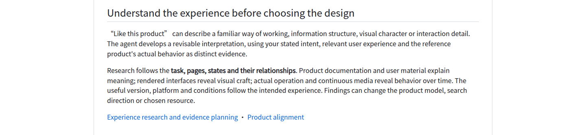
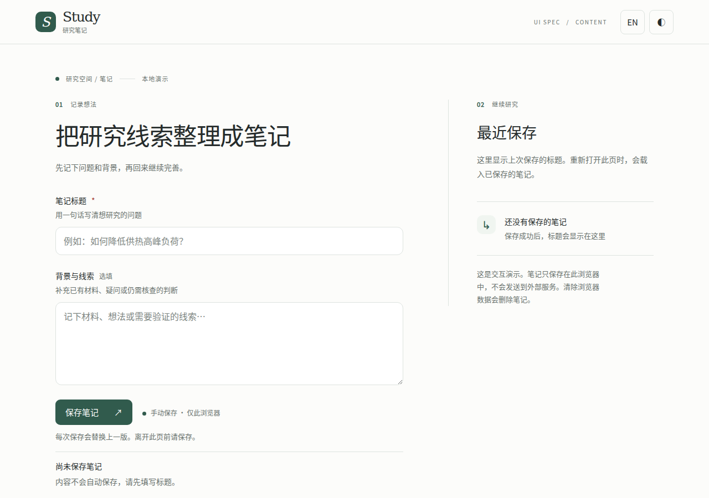
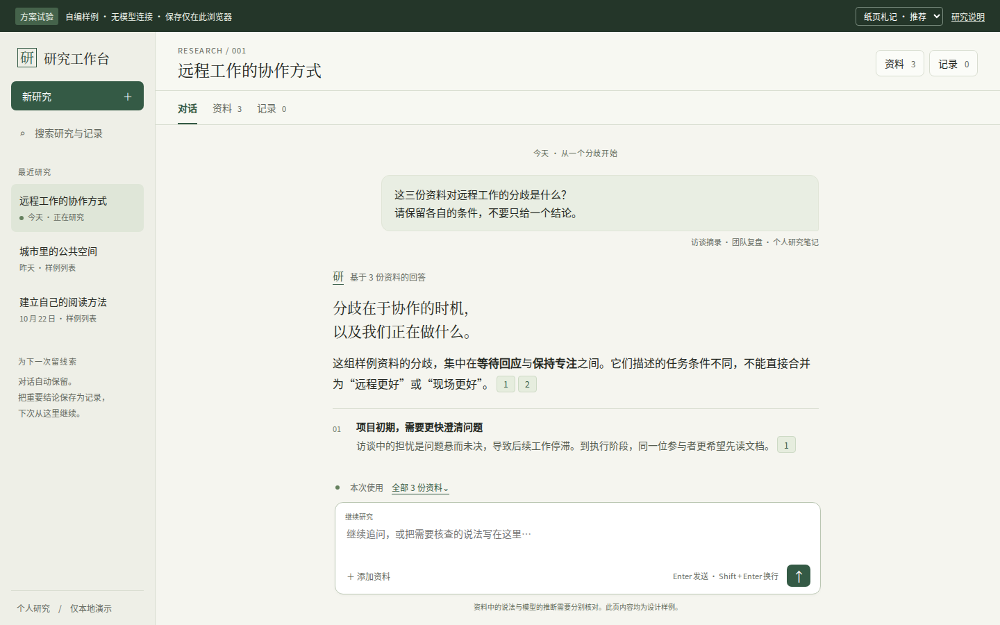

# UI Spec Studio 1.12.0 review

## Scope and accepted behavior

This release connects **Intent-Grounded Experience Research & Evidence-Driven UI
Design** to the existing professional foundation. The organizing relationship is
intended experience → revisable hypothesis → evidence questions → actual research
and comparison → mature-resource adoption → verification in use. New findings can
return work to the responsible earlier decision.

| Accepted requirement | Responsible implementation |
|---|---|
| Interpret a product analogy as a compressed experience | SKILL and analysis expand people, working objects, first action, continuing task, information relationships, perception and outcomes before committing to a new shell |
| Separate identity, capability and interaction model | Analysis derives the interface model from actual use; engineering names do not prescribe a dashboard, workbench or conversation layout |
| Distinguish three sources of expectation | Current-user intent, supported audience conventions and observed reference-product behavior retain separate authority and uncertainty |
| Plan evidence around the experience structure | Analysis connects pages, states, journeys and spatial/temporal relationships to research questions and appropriate evidence routes |
| Combine textual, visual and behavioral research | Text explains meaning and conditions; actual rendering supports appearance; operation and continuous media support behavior within their viewed scope |
| Preserve version and observation conditions | Analysis, sourcing and verification retain relevant date, version, platform, role, viewport and limitations; the latest product version is not automatically the intended reference |
| Support sustained, high-intensity exploration | Impact, uncertainty and plausible improvement govern depth, including many independent sources and hundred-step or hours-long research when valuable; no universal quota or time-based stopping rule is introduced |
| Expand the design space as findings develop | Sourcing follows clues across products, components, typography, materials, media and cross-domain expression; each round produces a useful next question or action |
| Challenge early preferences | Consequential candidates differ in composition, type, material, task organization or motion; repeated listings of one work remain one design lineage |
| Apply perceptual and temporal analysis | Existing whole → structure → detail → whole and frame → episode → journey methods inform candidate choice, adaptation and integrated review |
| Judge evidence sufficiency in five dimensions | Verification combines coverage breadth, inspection depth, temporal coverage, relevance and reliability instead of treating image counts as proof |
| Continue through access gaps legitimately | Sourcing pursues original projects, creator material, public demonstrations, recordings or authorized local rendering; necessary user assistance requests a specific page, state or episode |
| Keep facts, interpretation and missing evidence distinct | Observations, source assertions, professional judgments, captured-but-unviewed material and remaining gaps keep their own scope |
| Pair quality targets with implementation resources | Reference qualities remain connected to actual candidates, original demonstrations, local trials, adopted mechanisms and integrated results |
| Select the next action from evidence maturity | Continue research for consequential gaps, run a bounded trial when current conditions can answer fit, and expand implementation when important qualities and adaptations have support |
| Verify the complete result | Intended tasks, visual maturity, independent expression and engineering reliability are assessed at the actual product boundary; defects can reopen understanding, selection or adaptation |
| Preserve concise, inspectable decisions | Optional templates link goals, questions, observations, alternatives, adoption and verification; they do not require a search log, fixed schema or added approval round |

The [experience research guide](EXPERIENCE-RESEARCH.md) explains the complete method.
The existing product-alignment, reuse, design-decision and user guides use the
same responsibilities. `init → iterate → finish`, optional `shape`, `audit`
throughout, all eight common references and the mature-implementation default
remain. An established direction still supports direct, proportionate iteration.

## Source and distribution boundaries

The maintainer read the entry, eight common references and integration in full,
reviewed changed templates and public guidance, and compared the source with
v1.11.0. Detailed rules remain in their responsible references rather than being
copied as a second runtime manual.

A fresh-context source auditor independently read all 18 assigned files in full,
checked their additions and deletions against the same baseline, and examined 12
logical boundary scenarios. It found no release-blocking source defect or required
correction. Two nonblocking notes concern keeping routine-work exceptions close
to broadly worded comparison rules and the remaining reference-budget headroom.
The [source audit](evidence/v1.12.0/method-source-audit.json) records exact hashes,
reasoning scope and limitations; all 18 reviewed identities match the final files.
This audit did not inspect the application outputs or replace runtime checks.

The eight common references total **146,719 bytes**, below the unchanged
147,456-byte limit. SKILL is **166 lines**. The standalone skill remains **29
files**, with no new required runtime dependency. These are packaging and reading
cost measurements, not evidence of host-model understanding.

The complete skill was frozen before independent applications. Its path-sorted,
compact JSON file-hash map has SHA-256
`a5620a444436e00b9226ed8c59551d236fb11daeb58864ce80bbb96700019d5f`.
The [frozen identity](evidence/v1.12.0/frozen-skill-identity.json) records each file.
The final runtime files are checked against that input before publication.

## README self-application

The README remains a GitHub-native reading and installation interface. Its
introduction and first instruction now start with intended experience; a short
early section explains revisable product understanding and evidence planning.
The exploration section connects meaningful alternatives, real observation and
evidence maturity to the next useful action. Detailed methodology is linked from
the reading path. The established editorial SVGs and native installation path
remain the adopted foundation.

Local Chrome Headless Shell **143.0.7499.4**, Playwright **1.57.0** and an isolated
Noto CJK font configuration rendered English/Chinese × light/dark ×
390×844, 768×1024 and 1440×1000. The maintainer opened all **12 initial viewports**,
all **24 original-pixel crops** of the two changed sections, and **four full
documents as overviews**. A narrow Chinese guide link initially split after its
first character. The links now occupy their own paragraph in both languages;
the complete matrix was recaptured and its changed sections re-inspected.

The [narrow Chinese exploration section](evidence/v1.12.0/readme-exploration-zh.png)
shows the corrected guide group. Installation remains visible in the initial
390 px viewport. The existing Chinese multi-round-guide link wraps at 768 px
without lost text or clipping. No blocking visual finding remained in the
inspected scope.

The [local review record](evidence/v1.12.0/readme-local-review.json) identifies the
source hashes, actual viewed images, crop coordinates, environment and limits.
The renderer verifies image selection/alternatives, native installation text,
disclosure and document overflow. Its report now explicitly excludes clipboard
operation, which it does not exercise. The local stylesheet approximates GitHub;
actual-host rendering belongs to the exact-commit publication gate and separate
visual readback. Existing external README-source observations retain their
2026-10-25 date and were not presented as new research.

## Executed local engineering checks

| Check | Executed result and boundary |
|---|---|
| Repository structure, versions and local links | `tools/validate_package.py` passed on the revised source |
| Existing unit and failure-path tests | **153 passed**; these exercise declared helper and release-tool behavior |
| Generated artwork and resource map | `readme_art.py --check` and `catalog_docs.py --check` passed |
| Standard Skills CLI installation | Skills CLI **1.7.4** installed the local source for Codex, Claude Code and OpenCode target labels; 29-file identity and installed helper execution passed |
| Product fixture | **28 captures, 18 checks**, real local storage verified |
| Asset fixture | **8 views, 8 state checks** |
| Content fixture | **53 captures, 39 checks**, real local storage verified |
| Temporal fixture | **23 episodes, 223 captures**, storage verified; this local run used `--no-video` |
| Official Agent Skills format reference | `skills-ref validate skills/ui-spec` passed with reference commit `69ef37e9424c0a7ea9dd2293b559e43ec8176379` |

The [engineering record](evidence/v1.12.0/engineering-checks.json) identifies
the executed commands, report hashes, fixture source and runner identities.

The local temporal run establishes its state assertions and generated samples;
those captures were not presented as continuously viewed motion. CI retains the
normal video-producing command and its own artifact/inspection boundary. The
fixture programs are existing authored scenarios, separate from the independent
applications below and from the consuming user's actual product.

The installed generic skill-creator `quick_validate.py` rejects `compatibility`
as an unknown metadata key. Running that same helper against unmodified v1.11.0
produced the same result. The field is valid in the
[Agent Skills specification](https://agentskills.io/specification), and the
official reference validator above accepted the complete revised skill. The
existing compatibility declaration is preserved. No validator result has been
rewritten or treated as passing when it failed.

## Independent application setup

Two fresh-context agents received ordinary tasks and the frozen 29-file skill.
They received neutral browser/font/runtime paths, without maintainer diagnoses,
expected libraries, anticipated designs, prior application results or sibling
outputs. One task requested product research and an implementable proposal; the
other requested a narrow change to an already selected interface. Each agent
selected the relevant research depth and owned its work.

The content task initially received only HTML because of an input-setup omission.
The agent identified the missing files, and the original CSS and JavaScript were
supplied before it changed implementation. The final input is the complete
three-file content fixture at v1.11.0. The omission and correction remain in the
application record. The ordinary prompt called the input a help-article editor;
the actual source described research notes. The agent retained that existing
business contract rather than silently changing the work object.

These applications provide bounded observations of actual behavior. They are
not a comparative model campaign, a measure of general improvement, an audience
study or owner acceptance of a consuming product.

### Scoped bilingual content refinement

The agent retained the established Study identity, green/gray themes, two-column
layout and narrow stacked form. It inspected the existing page and state behavior,
then refined the save result into a short outcome plus consequence or recovery
instruction. Initial editing now reveals unsaved changes; the save button shows
pending work; success distinguishes the submitted snapshot from edits made during
the save. Simulated failure and actual browser-storage exceptions have different
explanations. Reading and clearing failures retain truthful recovery instructions.

The static English line now says **Manual save · This browser only** instead of
implying a successful write. Single-note replacement, reload behavior and clearing
consequences are explained where relevant. The original key
`ui-spec-content-note-v1`, `{title, body}` schema, snapshot writes, failure-preserved
input and read/retry mechanisms remain. Layout changes are limited to status
hierarchy, text reflow, readable helper type and usable recovery controls.

The agent compared existing inline wording, a two-level inline state and a modal
presentation, then used the two-level inline state to preserve editing context.
Primary W3C and GOV.UK materials supported status, reflow and recovery semantics;
the existing project remains the actual component and visual foundation. No new
component runtime or broad product-direction exploration was introduced.

The [narrow recovery view](evidence/v1.12.0/content-narrow-recovery.png) shows the
simulated-failure explanation and adjacent retry. The
[snapshot result](evidence/v1.12.0/content-saved-snapshot.png) distinguishes a saved
submission from later edits. The complete final three-file output is retained as
a [local application](evidence/v1.12.0/content-application/README.md).

The final authored browser run passed **113 assertions** and generated **72
captures**. It exercised 320/390/1280 px, both languages and themes, real local
save/reload, controlled write/read/remove failures, retry, pending-save edits,
duplicate submission, clearing cancellation, input preservation, long content,
focus and text-spacing conditions. The monitored page, console and external-request
lists were empty. Fault injection and actual successful storage remain distinct.

After its final wording refinement, the author reran the checks and viewed all
24 final viewport captures and 12 original-size four-variant state sheets. The
maintainer separately read the final state implementation, diff and report and
opened eight representative final images. No blocking issue was found in that
sample, and no maintainer-directed repair was needed. Source hashes match the
passing report and retained implementation.

A discarded CSS-element-zoom probe is recorded as an invalid proxy for native
browser zoom. It was not converted into a passing claim. Native browser zoom,
real handset keyboards, other engines, actual screen-reader output, continuous
motion/performance and real-user understanding remain unverified. The
[application record](evidence/v1.12.0/content-application-review.json) preserves
the ordinary prompt, input correction, source identity, actual viewing and limits;
the [runtime record](evidence/v1.12.0/content-runtime-checks.json) retains executed
assertions and capture conditions.

### Open product research and an implementable proposal

The second ordinary task asked for a personal research assistant: upload materials,
ask questions, inspect citations and revisit research. Its engineering name was
"research workbench", while the user explicitly wanted everyday conversational
work. The agent interpreted that experience before choosing a shell, separated
user intent from audience hypotheses and reference-product observations, and
researched both target relationships and possible implementation resources.

The study used official product material, historical/current conditions, actual
public-page observations and original component demonstrations. Nine acquired
official media items include three GIFs inspected through ordered samples and
selected original-size frames. This supports the observed state relationships;
the agent did not claim full natural-time playback or measured service latency.
Pinned repository/package/license material informed implementation boundaries.
The [provenance record](evidence/v1.12.0/experience-research-provenance.json) retains
source URLs, revisions, identities, observation conditions and limits without
redistributing the third-party media or source downloads.

The agent compared three structures using the same authored materials, question
and answer: conversation first with evidence on demand, persistent three columns,
and document first with a supporting conversation. Its recommendation follows
the requested daily work rather than the project's name. The comparison retains
the useful alternatives: both conversation and three-column versions have a
700 px answer column at 1440 px; at 1024 px the respective widths are 700 and
567 px. The document-first version allocates 328 px to conversation at 1440 px.
Those measurements explain space allocation, not user preference or task speed.

The [three-column comparison](evidence/v1.12.0/experience-three-columns.png) and
[document-first comparison](evidence/v1.12.0/experience-document-first.png) retain
their different task priorities. Two visual directions also change type roles,
reading density, sidebar weight and rhythm: the recommended paper-note direction
and the [index-desk alternative](evidence/v1.12.0/experience-index-direction.png).
Paper-note was inspected at 1440/1024/390 px; the index direction was compared at
1440 px. The report does not imply both directions covered every viewport.

Resource research led to a proposal to trial a complete assistant-ui Thread/runtime
before expanding the product. The inspected full-application template's default
file pipeline did not meet this study's private-document needs; source and citation
versioning remained application responsibilities. No assistant-ui, shadcn or Vercel
runtime was installed, integrated or adopted in the local probe. The authored
HTML/CSS and fixed sample data test layout and limited flow relationships only.

Actual viewing found a consequential local failure: at 390 px the reading column
was **zero width**, even though the no-horizontal-overflow assertion passed.
The agent corrected grid placement, added a minimum-reading-width assertion and
recaptured the result. The [failed view](evidence/v1.12.0/experience-narrow-before.png),
[repaired view](evidence/v1.12.0/experience-narrow.png) and original measurements
are retained. This repair came from inspecting the rendered interface.

Independent output review then identified evidence/source revision drift, a sample
claim whose citations did not directly cover both parts, an overly broad visual
coverage statement, and wording that could imply full record persistence. The
agent synchronized the final run and images, corrected the citation mapping,
narrowed the coverage and save wording, and exercised failed local writes.
The [independent review](evidence/v1.12.0/experience-independent-review.json) keeps
the initial findings and final dispositions. These review-directed corrections
are distinct from the original forward application and its own visual iteration.

The final bounded run passed **15 assertions** and produced **15 captures**.
It checked citation opening/closing and focus return, draft retention, visible
source scope, prior-answer scope, empty scope, narrow dialog behavior, local
draft/favorite-marker reload, failure-write feedback and reading visibility.
The author opened all final captures. The maintainer separately read the study,
current decisions, trial and run records and opened nine final views plus the
original narrow failure. The [narrow citation view](evidence/v1.12.0/experience-narrow-citation.png)
shows the sampled source context and return relationship.

Saving persists a favorite marker and draft; record text, citations and versions
are predefined fixtures. No real document parsing, PDF/OCR, model, retrieval
correctness, server persistence, mobile keyboard, audience study or owner approval
was established. The next proposed check is a real document → answer → citation →
saved record → revisit flow using the selected mature runtime. The
[application record](evidence/v1.12.0/experience-application-review.json),
[runtime record](evidence/v1.12.0/experience-runtime-checks.json) and
[capture record](evidence/v1.12.0/experience-capture-record.json) distinguish these
actual and proposed states, retain final source identities and identify which
local outputs are represented in the public bundle.

## Publication boundary

The existing workflow requires the OS/Python tests, local and exact-commit
installation, local and actual-GitHub README checks, and product/asset/content/
temporal scenarios before release. Its publication tool verifies clean source,
repository identity, source commit and existing-tag protection, builds both
archives with inventory and SHA-256 sums, checks downloaded draft assets, publishes
and reads the release back, then installs the tag.

This source review does not predeclare a future CI or release result. The actual
Actions run, release tag and downloaded asset checksums identify publication of
this reviewed source. Existing published tags and unrelated work are preserved.
