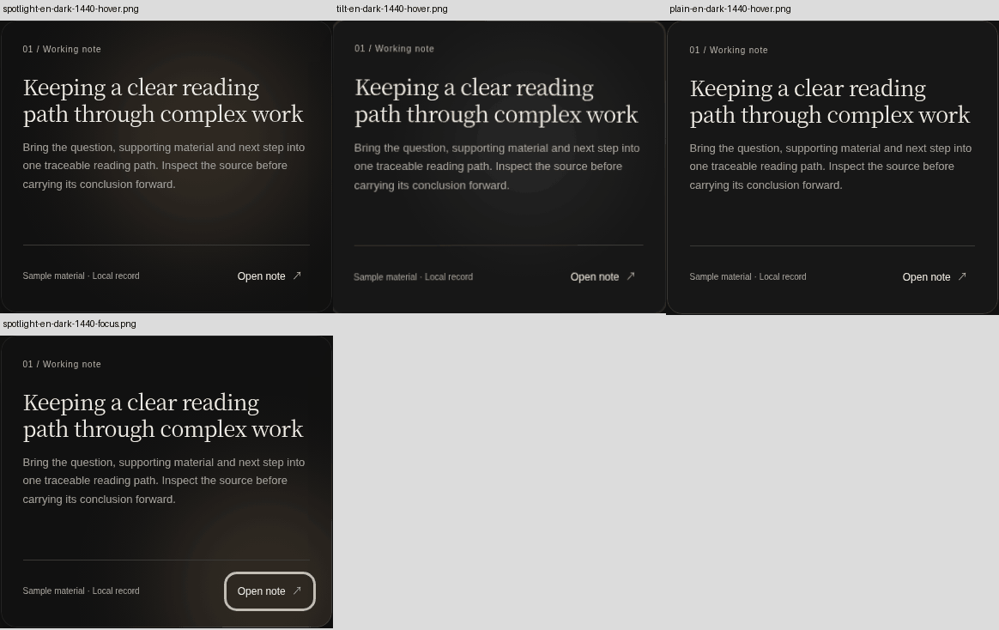

# UI Spec Studio 1.16.0 — reuse the visual craft

## Delivered method and evidence limits

This release strengthens discovery, selection, adaptation and actual-use checks
for **mature visual implementations**, not simply functional dependencies. It
integrates specific craft reasoning into the existing method and keeps the
v1.15 neutral structural-inspection boundary. The intended benefit is better
actual UI; writing the method and passing engineering tests do not establish
that benefit across models or projects.

**Independent Agent comparisons, complete-product alignment trials and a full
expressive-workspace trial remain unexecuted.** The available ACS project query
returned a disconnected tunnel. Connector discovery did not supply an alternative
independent UI runner. A bounded maintainer application was actually rendered,
operated and inspected; it is reported separately below, not relabelled as one
of those independent experiments.

## Requirement-to-implementation map

| Requested capability | Runtime or maintenance implementation | Evidence boundary |
|---|---|---|
| Mature visual work before recreating effects | Entry and component-sourcing distinguish the resolved relationships to inherit | Instruction/source review; not a tool-enforced ranking |
| Reuse scope versus visual completeness | Independent professional axes and appropriate-granularity choices | Descriptive lenses, no numeric cutoff |
| Functional, visual and integrated result | Explicit separate objects in sourcing and verification | A dependency list does not certify a visual result |
| High-level components, blocks and pages | Open discovery methods, existing catalog form/role metadata and query examples | Leads are documentation classifications, not endorsements |
| Craft changes the next search | Five connected lenses and mechanism-specific questions | Flexible thinking and observed behavior, not required forms |
| Finesse contribution without style cloning | Type/material/composition, interaction failures and observable explanation distributed across existing refs | Exact source readings and deliberate exclusions in the adaptation note |
| Expressive professional interfaces | Explicitly preserve task reliability alongside independent art direction | Category is not an aesthetic ceiling; populated use still matters |
| Motion effect, input ownership and route | Mature components first, continuous-input and quiet-state questions | Constants and engine choice remain contextual |
| External positive examples | Real products, demos and source items are primary study objects | No new internal showcase, vendor code or fonts in the Skill |
| Actual adoption and preserved quality | Reference/demo/trial/implementation/integrated chain in existing record and map | Source identity separate from perceptual success |
| Current judgments stay revisable | Existing current model/revision/archive and repair methods | No parallel lifecycle or irreversible maturity state |
| Neutral structural inspection | All installed helper scripts and optional structured record schemas unchanged | No new candidate count, quality score or action predicate |
| Cumulative knowledge | Every prior runtime file and historic evidence identity tracked | Exact reversible source check, not semantic-effectiveness certification |
| Real task evaluation | Three matched task families and separate actual bounded study | Pending independent trials are explicitly identified |

[Chinese method guide](VISUAL-CRAFT-REUSE.md) ·
[Finesse reading and adaptation](FINESSE-ADAPTATION.md) ·
[Actual-task protocol](experiments/visual-craft/PROTOCOL.md).

## Specific improvements in resource selection

`component-sourcing.md` is the principal rule owner. A page/block can preserve
coordinated spatial and state relationships; a small visual component can carry
resolved material or motion; an interaction primitive can supply reliable
semantics while leaving appearance open. Choose the useful scope and inspect
its craft rather than ranking the library name or largest package.

The source chain is connected early enough to change a design: a promising
external implementation may improve the target, while a local trial may reopen
selection. Professional craft knowledge becomes queries, observed distinctions,
public configuration choices and retained mechanisms. Custom work is justified
by a specific unmet condition, not simply by agent familiarity with CSS or GLSL.

The catalog retains all **37** previous items and their dates/claims. Fifteen
receive descriptive role, reuse-scope and visual-form profiles. The new
`visual-component` form supports existing filtering; results stay alphabetic.
No quality score, vendor ranking or generated next action is added. The existing
Finesse UI design-kit entry and mouse-lin/Finesse Skill are explicitly different
sources. New spot-check dates do not overwrite the original 2026-10-24 snapshot.

## Finesse: what was actually read and transferred

Research used fixed source `c7a91448baf6e98fecf542915cdb7e3155bddc45`:
`design-dna.md` lines 1–180, `motion.md` lines 1–125,
`interaction-motion.md` lines 1–125, `plain-words.md` lines 1–90 and the full
license. These are **scoped readings**, not a claim to have inspected all examples
or accepted all upstream technical assertions. The absent guessed
`motion-crafting.md` was replaced by locating the actual files.

Transfer mechanisms and failure analysis: actual type metrics and roles,
coordinated surfaces/light/edges, composition and optical mass, timeline versus
input ownership, direct tracking versus residual easing, velocity/threshold
uncertainty, quiet-state composition and plain descriptions of visible results.
Turn these into source-selection and adaptation questions before custom recipes.

Do not transfer mandatory grain, universal palette/font constants, spectacle
scores, banned visual forms, fixed engine ordering or the professional-product
expression ceiling. No complete Finesse implementation or asset corpus is copied.
Relevant accessibility and platform facts are checked against primary W3C/MDN/
library material rather than inherited as general facts from a style recipe.

## Actual bounded source-adoption application

[Application observation](evidence/v1.16.0/application-review.json) connects
source identity, explicit adaptation and viewed output. The input was an already
prepared development-branch application at
`7d276ee220aa57442e43096a178964359ae65e13`, acquired from workflow
40536750577/artifact 12747644228. It uses exact React Bits SpotlightCard and
TiltedCard source at `e12c22192ac7b4b452c5e2feb9b586d74765d696` in a sample
research-note reading task. This turn added the host styling, operated the
application and reinspected source and candidate evidence. It was not generated
by a fresh independent agent consuming the completed release.

The official Spotlight capture and ten pointer-sample frames were viewed; the
Magic Card documentation image was inspected only as static context. The public
TiltedCard capture displayed a loading placeholder, so it was not treated as
visual confirmation of that demo. Exact-source local TiltedCard rendering is
separate evidence, not a fabricated substitute for the missing live observation.

The application compared a stationary text plane with moving light, a tilted
plane and a native static card using the same supplied content. The selected
Spotlight treatment retains its light falloff and edge mechanism through public
configuration. In the observed reading task, type stays stable while the light
moves; the tilt candidate changes the reading plane and text rendering. This
supports a local choice, not a library-wide ranking or measured user preference.

This small display preview uses a reduced color palette. Judgments used the
original-pixel captures, preserved with their exact hashes in the separately
delivered `ui-spec-1.16-review-evidence.zip`; the preview is not measurement
evidence or a substitute for those originals.

A mobile capture exposed excess whitespace from inherited desktop minimum
heights. Changing only the host's narrow-layout heights preserved the mature
mechanism and brought text and action closer. The final narrow capture was
actually re-viewed. Six named language/theme/viewport/candidate conditions ran
**36 explicit functional/layout assertions**, all passing; an additional
reduced-motion/touch-emulation capture was viewed separately. Sampled episodes
show selected temporal appearances, not continuous playback or frame-rate proof.

Local HTTP navigation was rejected by the environment. The successful tests used
an offline Chromium fixture made from acquired local application bytes; no
served-origin/network result is claimed and the forbidden origin was not
bypassed. Search, open/close, empty state, theme and document-overflow assertions
have their exact scope. A 280ms sample delay is authored fixture behavior, not a
performance measurement or production service integration.

The source license is **MIT + Commons Clause**, with component-redistribution
restrictions. No standalone upstream components, compiled vendor bundle or
showcase library is shipped in the Skill or source release. The retained material
is source identity, observations, a small display preview and method records.
Original captures are supplied separately rather than building a bundled showcase.
Prompt-kit source and the Aurora directory were additional research only, not
successful additional adoptions.

## Content preservation and inspector responsibility

The baseline is v1.15.0 commit
`a89091dfa5754f98b79655c684f978f24fd92716`, tree
`03e3c14508244551a18711aff28363452871e2ed`.
All **37** prior runtime paths remain. Existing professional references and the
decision template receive additive guidance; entry insertions and catalog
metadata are tracked. Every installed helper, the coverage vocabulary and the
optional JSON records remain byte-identical. No size cap is reintroduced.

The [continuity ledger](evidence/v1.16.0/continuity.json) checks current identities
and reconstructs exact predecessor bytes using minimal reversible line edits,
with each edited fragment separately hashed. This permits current additions
without falsifying v1.15's exact-source checks. The older ledger is unchanged and
is evaluated against its exact reconstructed source; independent new tests check
the actual current files. The **100** pre-existing evidence files retain their
identities. A byte-preservation check protects content, not its actual influence
on a model's choices.

## Engineering checks and publication

Local commands and results are recorded in
[engineering-checks.json](evidence/v1.16.0/engineering-checks.json).
The existing package/link, catalog, artwork, unit, reproducible-build and
installation checks remain. The unchanged release workflow separately requires
four OS/Python combinations, local and exact-commit installation, bilingual
local and GitHub rendering, product/assets/content/temporal fixtures, asset
readback and published-tag installation. Existing fixtures are not new Agent runs.

The [README application](evidence/v1.16.0/readme-review.json) records actual
observed source/conditions separately from screenshots merely captured. The
native publishing surface is retained rather than importing a web component
into a host that does not run it. This is another scoped maintenance application,
not a complete product alignment or a general improvement claim.

This document does not predeclare remote CI or a public release outcome. The
final workflow, exact tag and downloaded artifact identities establish those
facts. Independent behavior, user comprehension, artistic quality across tasks
and measured development-time savings remain separate empirical questions.

## Final local execution

The completed local suite ran **245 tests, all passing**. The first run had four
failures: three package/link assertions found observation records not yet written,
and one new identity test used a prose name rather than the explicit source slug.
The actual records were then written and the identity assertion corrected. The
application-summary script also initially counted a capture-only row as an
assertion row; the browser results were not altered. These attempts remain in
the engineering record rather than being relabelled successful.

The real copy installer produced **37 byte-matching runtime files** and all five
installed helpers executed. Structural outputs still have readability/findings,
not a project-completion flag. Twelve local README conditions were captured and
the changed sections actually viewed. A narrow Chinese heading's isolated final
character was repaired, followed by a complete recapture and reinspection.
The actual GitHub host, standard CLI remote install and published asset readback
remain separate release-workflow facts.

## Post-release empirical findings (2026-10-28)

The statements above describe evidence available at the original publication.
A new, separately registered local cohort now completes **12 independent
fresh-context implementations**: three task families, both full production
versions, and two repetitions per cell. Each output received all 37 unchanged
runtime files from its assigned v1.15.0 or v1.16.0 tag. This is not a weakened
baseline or a replacement for the earlier incomplete cohort.

The tasks exercise a complete populated research frontend against a fixed Vane
author reference (T1), an expressive twelve-project professional workspace (T2),
and a bounded source-reading sheet inside an accepted notebook (T3). They use
local authoritative service fixtures; commercial backend parity is not measured.

Independent browser checks found **59/60**
acceptance groups passed for v1.15.0 and
**58/60** for v1.16.0. Failed groups
remain in the record, with the same criteria and no evaluator repair of outputs.
Supplemental assertions remain inside their original ten groups.

One raw mobile theme lookup timed out because the existing theme button lived
inside the public history drawer. A separately retained route-only adaptation
was applied to all four T1 outputs with unchanged builds and pass criteria.
Only group 09 uses that later observation; all other groups keep their original
results. The raw timeout and both sets of evidence remain available. All four T1
anonymous packets use the same adapted stable-capture procedure.

| Task | Repetition | v1.15.0 groups | v1.16.0 groups | B minus A |
|---|---:|---:|---:|---:|
| T1 | 1 | 10/10 | 10/10 | 0 |
| T1 | 2 | 10/10 | 10/10 | 0 |
| T2 | 1 | 10/10 | 10/10 | 0 |
| T2 | 2 | 10/10 | 10/10 | 0 |
| T3 | 1 | 9/10 | 9/10 | 0 |
| T3 | 2 | 10/10 | 9/10 | -1 |

Three fresh-context, version-blinded model reviewers locked six separate ordinal
dimensions and all six paired preferences before joining the version map. Their
18 paired judgments favor v1.15.0 **11** times and v1.16.0
**4** times, with **3** ties and
**0** undecidable judgments. Exact scores,
within-reviewer paired differences, disagreements, reasons and observation limits
are preserved. These are correlated model judgments, not 18 independent users;
no aesthetic total, percentage quality uplift or statistical significance claim
is made. Ordered frames do not establish natural continuous-motion quality.

The separate nonblind source audit follows actual integrated code, preserved
visual or temporal mechanisms, custom remainder and source/trial/result evidence.
Dependency names and source counts are not used as quality scores. Both versions
already contain substantial sourcing guidance; retained adoption alone is not
proof of a causal improvement or complete mature-product parity.

The earlier campaign remains **9 recovered outputs out of 12**, with three missing
outputs, three complete functional pairs and no recovered blind ratings. It is
reported separately; the new cohort does not fill its missing cells. Approximate
wall time, the shared-service interruption, incomplete command records and
unobserved token/cost/active-compute measures retain their stated limitations.

**Owner feedback remains pending.** A portable offline comparison interface
provides actual retained builds, common viewports, original captures and videos,
the shared product reference, nullable ratings, version-exposure records,
timestamped score locks, preserved revisions and feedback export. No synthetic
QA input is counted as owner acceptance. Later actual feedback will be appended
without replacing these locked model observations.

The original v1.16.0 tag and four assets remain the release identity. This dated
addendum changes the empirical record, preserves the original publication status,
and leaves the later v1.16.1 release and v1.14.0 addendum intact.

[Detailed findings](https://github.com/D1ChangGeng/UI-Spec-Studio/blob/main/docs/experiments/visual-craft/RESULTS-v1.16.0.md) ·
[Machine-readable record](https://github.com/D1ChangGeng/UI-Spec-Studio/blob/main/docs/evidence/v1.16.0/empirical-findings.json) ·
[Protocol, locks and source audit](https://github.com/D1ChangGeng/UI-Spec-Studio/tree/main/docs/evidence/v1.16.0/empirical-20261028)
