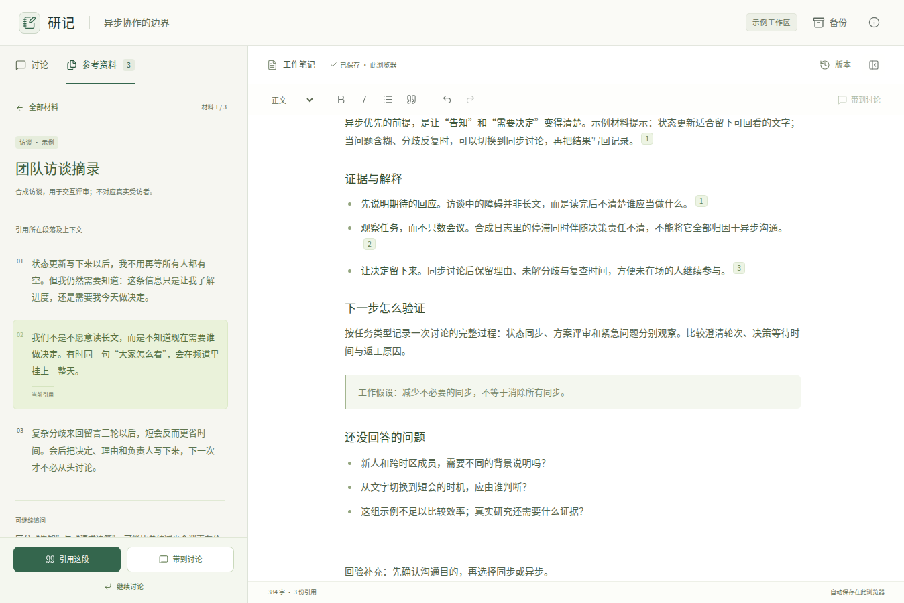
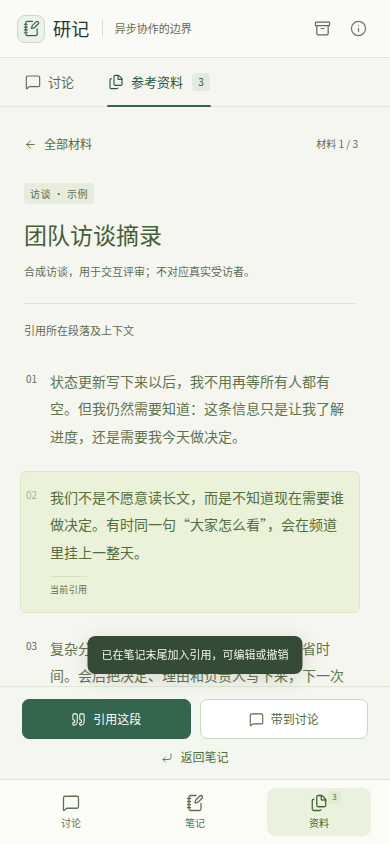

# v1.8.0 产品体验对齐与主动视觉探索审查

审查日期：2026-10-26（Asia/Tokyo）。本版在 v1.7.0 的视觉与时序观察方法上，
将产品 UI 体验对齐设为默认设计目标，并把主动探索接入研究、选型、实现与回验。
下文区分方法审查、实际应用、浏览器观察和工程验证的证据范围。

## 1. 方法与职责

| 要求 | 主要实现位置 | 实际指导的行为 |
|---|---|---|
| 默认产品体验对齐 | `SKILL.md`、`analysis.md` | 无论用户是否点名产品，都从当前任务建立成熟参照和体验目标 |
| 展开产品类比 | `analysis.md` | 区分官网、工作界面、流程、品牌及局部关系；将名称转成具体研究问题 |
| 组成、状态与关系 | `analysis.md` | 关键问题有依据，常规实例继承已研究的体系，重要未知引导下一步 |
| 线索触发主动浏览 | `component-sourcing.md` | 播放、滚动、切换、展开、控制空间展示或比较参数，继续获取有价值的证据 |
| 观察对象归属 | `component-sourcing.md`、`verification.md` | 分清载体页面、播放器、演示内应用和被展示作品，结论用于相应对象 |
| 时序观察 | `verification.md`、`interaction-and-variants.md` | 按行为确定窗口，按变化特征选择采样，保留动作、状态、顺序与观察缺口 |
| 选择检查工具 | `verification.md` | 由具体问题选择浏览、媒体、网络、动画或运行追踪，核实能力与授权 |
| 可迁移设计判断 | `analysis.md`、`principles.md` | 解释现象、可能感知、设计关系与适合继承的部分 |
| 两层复用与适配 | `SKILL.md`、`component-sourcing.md` | 继承成熟决策，选用适合的实现；将定制集中于已识别的差异 |
| 可运行方案同题回验 | `workflow.md`、`verification.md`、`integration.md` | 在当前内容、空间、状态和真实边界下重新回答原研究问题 |
| 证据边界与收敛 | `analysis.md`、`verification.md`、可选记录 | 按决策价值推进；区分采集、实际检查、结论充分性和用户批准 |
| 资产与内容参与 | `visual-assets.md`、`content-design.md` | 主动研究作品、字形、文案和动态素材，在实际界面中核实其作用 |

八份共同参考和 `init → iterate → finish` 保持连续；`shape` 与记录模板按任务需要使用。
专业方法由原责任文件承载，宿主继续管理工具、权限和上下文。新增公开说明为
[产品体验对齐指南](PRODUCT-ALIGNMENT.md)，安装包无需新的执行依赖。

八份共同参考合计 **145,011 bytes**，原上限 **147,456 bytes**；入口 **136 行**，
description **912 字符**。本版没有增加第九份共同参考，也没有放宽体积限制。

## 2. 来源核对

实际打开 USWDS、Design Council、GOV.UK、NN/g，以及 Chrome Network、Media、
Animations 和 Playwright Trace Viewer 的相应原始文档。来源与适用范围见
[指南](PRODUCT-ALIGNMENT.md#方法来源与适用范围)及
[技能来源](../skills/ui-spec/references/sources.md#product-alignment-and-active-exploration-18)。

这些材料支持用户需要、发散与收敛、组件适用性和检查能力的相关原则。工具文档
说明能力范围，实际宿主提供的能力与本次已经执行的操作分别成立。本文未把第三方
方法或工具文档作为本技能整体效果的认证。

## 3. 实际页面探索

维护者从公开的旧版 Artifacts 教程入口进入，页面实际重定向到
[Claude Academy 的 Artifacts 教程](https://academy.claude.com/tutorials/intro-to-artifacts)。
在连接的 Chrome 中查看页面画面，实际切换 Design 示例与 Comment to Claude 示例，
开启评论模式并选择图表，查看出现的目标边框与就地评论层。没有提交评论或进入账户工作区。

该页面明确将示例标为 Illustration、Explorer 或 Simulation。观察到的绿色手机作品、
白色编辑器框架和深色教程页面分别属于作品、模拟应用与承载页面。它们支持不同的
视觉参照。评论模式与图表选择的两个实际操作揭示了操作范围与对象边界的关系；
这些是教程模拟的状态证据，不能证明真实 Claude 服务的保存、协同或性能。

观察条件：连接的 Chrome，默认暗色页面，读取的 CSS 视口 1278×1296，DPR 1.5；
截图工具返回的显示尺寸与 CSS 视口分别保留。实际查看了入口、Design 示例、评论
示例初态、评论模式和图表选中后的画面。未据这些稀疏状态图判断动画节奏。

页面的视频播放入口实际点击后，YouTube 显示登录/反机器人验证要求；本次保留
“视频内容未观察”的范围，没有下载替代流或绕过访问限制。公开教程的独立模拟
区域继续提供其自身可访问的状态证据。研究标签页已关闭。

## 4. 独立实际应用

使用新的独立上下文，输入冻结的技能副本与普通产品任务；任务不包含维护诊断、
预期答案或其他应用结果。第一项仅要求方案，第二项要求可运行核心切片；均只使用
公开资料与示例，不操作真实组织数据或账户工作区。

冻结输入的 `SKILL.md`、八份共同参考及 `integration.md` 共十个方法文件与本版
最终方法逐字节相同。按相对路径排序，将路径到 SHA-256 的映射序列化为无空白 JSON，
再计算的摘要为
`2ae9571fc1295181695b4c99aa4668de83d5c53aa346674fc305da686b4fc6b6`。
后补的公开来源说明不属于这十个方法文件。两个应用分别完整读取共同参考；只读
自己任务与技能，未读取仓库维护说明或另一项结果。以下是具体应用观察，不是与旧版
的受控对照，也不代表所有宿主、模型或产品任务的表现。

### 4.1 无指定参照：社区活动筹备工具

普通任务要求小型社区组织查看当前活动、逐步补齐资料、离开后继续，并看清未完成
工作；没有指定参考产品或视觉风格。本轮范围为方案、实现基础与适配路径。

Agent 自主研究 GOV.UK 多任务清单与完成确认示例、USWDS 步骤条和 Asana 公开活动
模板，形成“活动清单 → 筹备页 → 编辑一个部分 → 保存返回 → 重返继续”的结构。
关键选择是自由顺序的分段清单，并将“资料是否保存”与“现实筹备是否完成”分开。
例如暂定地点可以已经保存，同时保留“待确认：等待场地负责人回复”。

| 实际参考与动作 | 支持的判断 | 保留的边界 |
|---|---|---|
| [GOV.UK 完整任务页](https://design-system.service.gov.uk/patterns/complete-multiple-tasks/default/)：观看画面、点击 Read declaration、查看焦点与 URL、后退 | 任务、分组与状态的空间关系；未完成项的视觉权重 | 示例链接仅增加 `#`，没有业务表单或真实恢复 |
| [完成一个部分](https://design-system.service.gov.uk/patterns/complete-multiple-tasks/have-you-completed-this-section/)：先选稍后继续，再选已完成，分别查看画面 | 用户可显式表达资料尚未准备好；互斥状态和焦点端点 | 没有提交 Continue 或验证保存；顺序截图不证明动画品质 |
| [USWDS 步骤条](https://designsystem.digital.gov/components/step-indicator/)：定位并查看默认、无标签、居中与数字变体 | 顺序提示与当前非线性任务的适配差异 | 组件预览未组成真实多页服务 |
| [Asana 活动模板](https://asana.com/templates/event-planning)：查看产品示意图，切换 Overview/How to 并滚动 | 活动中准备事项、责任和日期的内容关系 | 操作的是公开介绍页，图中的应用工作区没有实际操作 |

上述截图在应用会话中实际观看；没有另存截图档案或录制视频。因此这里保留可重现
URL、动作和观察，未将它们写为可离线检查的媒体包，也未作平滑度或延时结论。
云 Chrome 的完成选择页可用视口为 1363×936 CSS px；未测 DPR、手机或真实设备。
Browser 插件缺少 originating browser context 后，按其文档使用独立云浏览器标签，
完成后关闭；未登录账号或提交组织资料。

实现起点选择 GOV.UK Frontend 的任务清单页面模式及同一套表单、摘要和错误组件。
核对了可复现版本 `govuk-frontend@6.3.0` 的公开发布与去品牌化说明；没有安装，也未
称其为最新版本。方案说明自有中文字体、颜色、名称与资产，真实路由替换示例假链接，
存储、权限、版本与恢复由应用的实际边界负责。下一步切片集中验证部分填写、保存、
离开、重新进入与完成确认，并覆盖失败和并发；这些是待执行目标。

本次观察支持：没有产品名称时，技能可以引导该次应用自主建立参照、比较实质差异、
选择完整适当的复用层级，并形成有边界的适配方案。中文视觉数值、六个筹备分组与
实际志愿者理解尚未经过产品渲染或用户检验，不能从参考示例推定成立。

### 4.2 指定参照：研究笔记与讨论协同

普通任务要求个人研究笔记工具具有 Claude Artifacts 式的讨论与成果协同：核对材料、
继续编辑、回到讨论时保留工作，并完成桌面和窄屏的有界可运行切片。所有内容和回应
明确为合成示例，不接 AI、账号、共享或发布服务。

Agent 将名称展开为持续存在的笔记、讨论与材料的上下文关系。实际打开
[Claude 功能页](https://claude.com/features/artifacts)，切换 Living specs 并滚动；
记录了示例文档的分节、决定和未解决问题。视频播放尝试没有获得有效内容，未声称
看过其连续过程。[官方 Artifacts 帮助](https://support.claude.com/en/articles/17153992-what-are-artifacts-and-how-do-i-use-them)
提供相邻讨论与持续编辑的行为说明；公开示例仍是载体中的作品，未作为真实账户运行证明。
另研究了 Google 笔记工具的[引用上下文说明](https://support.google.com/gemininotebook/answer/16179559?hl=en)。

实现资源方面，实际操作 [Tiptap Simple Editor](https://template.tiptap.dev/preview/templates/simple)，
输入中文并撤销，查看示例画面与控件状态。选择 Tiptap 3.32.0 的编辑功能块、Lucide
1.61.0 图标与原生控件；定制范围是引用节点、研究布局与状态延续。采用“笔记固定，
左侧讨论/资料切换”，比较后舍弃默认三列；窄屏保留同一对象，通过三个视图切换。
完整 React 编辑器页面超出所需范围，未将整页采用比例作为复用质量标准。

独立应用完成构建和状态检查，但其云浏览器无法访问执行环境的 localhost；主任务
的扩展浏览器得到相同连接错误。文档支持的共享文件尝试又被 `file:` URL 安全策略
拒绝，随即停止。独立应用没有把构建成功写为原型已经得到视觉验收。

随后主任务在执行环境内运行隔离的 Chromium 工程测试，并实际查看生成画面。
这属于补充验证，分别保留了首次应用、具体复现反馈和后续修订：

| 发现 | 原因与修订 | 最终复验范围 |
|---|---|---|
| 专注笔记后点击引用或选文带到讨论，目标仍隐藏 | 视图状态已切换但专注样式未退出；显式操作现在揭示目标区域 | 桌面引用及选文两条实际路径，草稿保持 |
| 保存成功后自身恢复拒绝长正文或多条消息 | 读写限制不一致；共用解析契约并保留完整输入 | 250001 字、501 条消息及长草稿/选文回读；代码节点支持 |
| 中文备份可保存却超过导入大小限制 | 码元与 UTF-8 文件字节混用；统一 4 MB 字节上限 | 边界内完整回读，超限不写旧记录、不报保存成功 |
| 窄屏资料刷新后返回，焦点落向隐藏讨论输入 | 原触发点未能跨刷新保存；增加可见笔记区域回退 | 实际刷新、返回与焦点检查 |
| 窄屏动作只有隐藏文字或前置提示 | 补充明确的动作名称 | 备份和带到讨论的可访问名称检查 |
| 引用后立即查看资料，残留 toast 遮挡底部动作 | 按当前视图固定操作区实际位置调整反馈 | 390×844 实际画面及不重叠测量 |

首次浏览器检查 **16 项中 15 项通过**，实际查看全部 10 个画面，发现专注模式问题
及反馈遮挡。最后的 **23 项路径检查与 10 项状态用例通过**；实际逐张查看最终
11 个画面，源码在该次运行前后一致。条件为 1348×900 与 390×844、DPR 1、中文、
浅色、已配置 Noto CJK 的隔离 Chromium。检查覆盖引用、编辑、草稿、刷新恢复、
目标揭示、焦点、动作名称及存储失败；真实手机软键盘与辅助技术未据此验收。

初稿的 450 ms 人为示例等待已由作者在工程自查中取消：固定回应与用户消息同步
进入状态，避免假装真实 AI 请求或在刷新时留下半个回合。一次复验仍保留旧等待
断言而中止，核对源码与改动理由后改为检查实际同步反馈；另修正了测试在空段落
使用行首选择而未选中文字的操作。未修改产品去迎合这两个测试观察错误。
最终原型不覆盖生成等待、取消、重试或流式响应。Trace 已记录但未回放；顺序截图
不支持连续帧率、完整动效品质或真实服务延时结论。

代表性最终画面与输入/源码身份、检查明细保存在
[应用证据记录](evidence/v1.8.0/application-review.json)。这些是临时应用对象的
研究与验证证据，未将其作为另一款随技能发布的产品。

桌面：从专注笔记进入引用材料后，资料与同一份笔记并列。



窄屏：引用反馈位于固定动作区上方，引用、带到讨论及返回笔记保持可见。



## 5. README 实际视觉检查

使用仓库现有 Markdown-It / GitHub-like 近似渲染器与 Chromium，DPR 1，配置 Noto CJK。
中英双语 × 明暗主题 × 390×844、768×1024、1440×1000 共 12 条件；每条实际打开
viewport 和 full-document 截图，另查看 12 个原分辨率新段落裁切。

新段落的标题、正文、强调、链接和换行正常，CJK 字形清楚；主安装命令块位于本地
首屏。390px 长命令保留原生容器横向溢出，文档级横向溢出检查通过。此处没有
额外验证代码容器的实际横向操作，也没有将本地呈现结论扩展到 GitHub。

完整测试发现新版段落省略了原有资源复用指南入口。恢复中英可见链接后，重新
生成全部 24 张截图，并实际复查全部 12 个受影响段落裁切。前述 24 张全图逐一
查看属于链接修正前的文字版；最终源码的局部复查覆盖了此次变化，未重复声称
逐张打开全部最终全图。既有导航测试保持原要求并通过。

最终 README 源码身份：

```text
README.md     aaecee7044ac2f074c2b1f64356763c0663b7f10f5eea026d46656105656023c
README.zh-CN.md 68f65f647ce2d84691efa5662a40d50d262e77c4fadb7f211667cc026f7874ae
```

## 6. 工程验证与发布

已执行的本地检查：

| 检查 | 结果与边界 |
|---|---|
| 包结构、版本、共同参考、本地链接 | 通过 |
| README 插图和资源目录生成一致性 | 通过 |
| 完整单元测试 | **153 项通过**；包含现有工具、边界、可重现包与导航契约 |
| Standard Skills CLI | 使用 `skills@1.7.4`，请求 Codex、Claude Code、OpenCode 目标；实际两份安装副本各核对 29 个源文件，并运行三个随包助手 |
| 本地 README 浏览器检查 | 12 条件，原生文字、折叠、主题插图和文档宽度检查通过；实际像素查看范围见上节 |
| 源码空白/补丁检查 | `git diff --check` 通过 |

安装第一次在受限环境发生网络/缓存权限错误；在批准的网络执行范围内、使用
临时缓存重跑后通过。没有更改安装器要求或减少核对文件。安装检查证明发现、
复制和助手运行；宿主内模型行为由前述独立应用提供其各自范围的观察。

既有产品、素材、内容与时序浏览器门禁继续使用各自真实边界。正式发布需通过
全部 CI 门禁，工作流将逐个下载并核对发布资产；实际提交、标签、Release 和 CI
结果以对应版本的远端记录为准。发布读回另核对这些身份与分发文件。

## 7. 结论适用范围

本版的方法、源文件与实际应用提供对应范围的证据。真实用户理解、所有宿主模型的
设计能力、真实设备性能和外部业务接线仍由相应观察与验证建立。固定浏览数量、
截图数量或录制时长没有作为探索完成标准。
