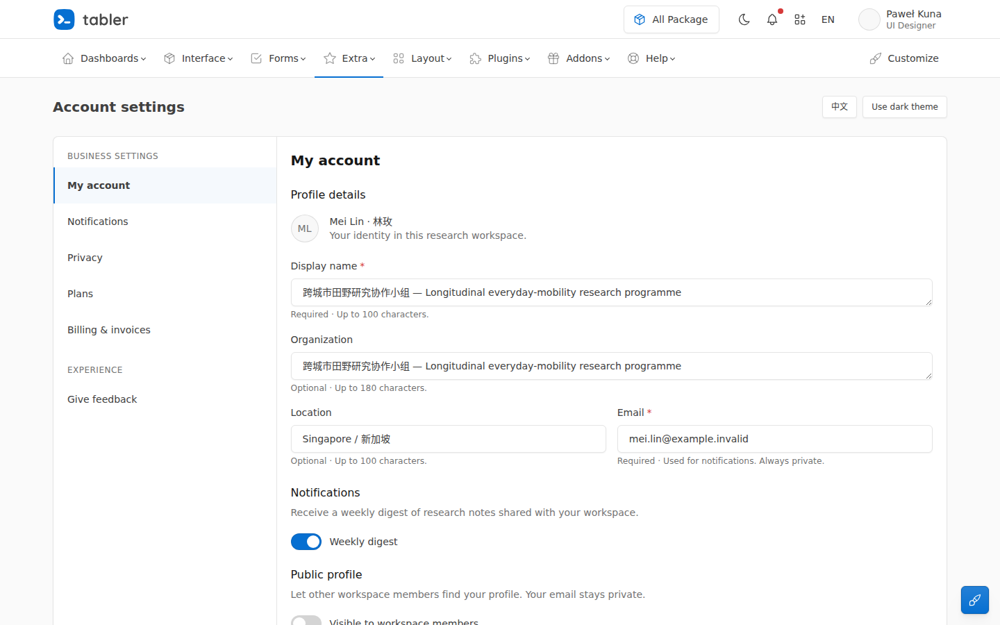

<!-- Derived navigation copy; never use as an original participant export. -->

> Repository navigation copy. The participant report is retained byte for byte in [FINAL.md.txt](FINAL.md.txt) and the workspace overlay archives. Only local artifact link destinations below are adapted for this repository.

# Fieldnotes settings — delivered

Implemented the complete settings increment in the existing Tabler application. Profile, notifications and privacy now share coherent form hierarchy, bilingual copy, real validation and save feedback. The authoritative browser-local store and its validation, persistence, delay and failure fixture remain unchanged.

## What changed

- **Readable profile fields:** name and organization use Tabler form controls that grow to show the entered text. The required long Chinese/English example remains visible and editable at desktop and narrow widths.
- **Clear validation:** required-field guidance, field-specific errors, `aria-describedby`, `aria-invalid`, and focus on the first invalid field.
- **Truthful save states:** pending, failure, retry and success use Tabler alerts and its loading button. Error text uses the system’s emphasis utilities for readable light/dark contrast.
- **Correct pending edits:** a successful save reports the submitted snapshot. Later edits remain in the fields and are explicitly described as unsaved.
- **Keyboard recovery:** Save regains focus after a failed or successful attempt when disabling it moved focus to the document body. Focus remains with the user if they moved to another field.
- **Draft continuity:** language and theme switch in place. Cancel restores the last persisted settings. Reload and return read the actual saved value.
- **Narrow composition:** the existing settings navigation collapses using Tabler’s native pattern; utility buttons have their own responsive header row. The gallery’s floating customizer no longer overlaps the narrow form.

The implementation changes are in [index.html](artifacts/app/index.html) and [settings-controller.js](artifacts/app/settings-controller.js). No new runtime dependency or original visual construction was introduced.

## Preview

From the application directory:

```bash
cd /workspace/scratch/708e8b7f118e/ui-study/worksets/w01/app
python3 -m http.server 4401 --bind 127.0.0.1
```

Then open [English / light](http://127.0.0.1:4401/?theme=light&lang=en) or [Chinese / dark](http://127.0.0.1:4401/?theme=dark&lang=zh). Add `&fail=once` on a fresh load for a failed valid save followed by a successful retry. The verification server was stopped after the captures; no build or installation is required.

The final settled previews were personally opened and inspected:



[Narrow Chinese / dark preview](artifacts/evidence/delivery-zh-dark.png) · [Narrow failure and retry state](artifacts/evidence/final-r4/zh-dark-narrow-failure.png)

## Verification

The full browser run covered English and Simplified Chinese, light and dark, at **1440×900, 1280×600 and 390×844**. It exercised the skip link, keyboard editing, validation, switches, saving, one failure, retry, newer edits during pending, Cancel, reload and return. It passed **141 assertions** and reported no uncaught page exceptions. The final affected-state run passed **28 assertions**, including stable loading-button width, keyboard focus restoration, touch-sized recovery and unreadable-storage preservation. Final snapshot/edit separation was checked again in all four language/theme combinations. See [verification.json](artifacts/evidence/final-r2/verification.json), [final-state verification.json](artifacts/evidence/final-r4/verification.json), and [concurrency verification.json](artifacts/evidence/final-concurrency/verification.json).

Actual command exports, source-tool responses, captures, view-image responses and failed attempts are retained. The first keyboard test exposed focus loss, and the initial reference capture returned 404; both were corrected and remain traceable. Error-alert text contrast was measured at approximately **15.40:1 in light** and **6.03:1 in dark** after applying existing Tabler emphasis utilities. This is a scoped measurement, not a complete accessibility certification.

## Sources and observation limits

The retained foundation is **Tabler 1.7.1**, tagged revision `07f60c07da13d8ff957a370434b7ef5c86f5ab94`, plus the supplied official settings snapshot identified by its digest. The MIT notice, local distribution files and original source references remain intact. Actual adoption and modifications are documented in [SOURCES.md](artifacts/SOURCES.md.txt) and [DESIGN-DECISIONS.md](artifacts/DESIGN-DECISIONS.md.txt).

No blocking defect remains in the exercised settings path. The retained outer Tabler gallery chrome still contains its placeholder identity and English gallery menus; unrelated gallery routes remain outside this bounded product contract. Verification used Chromium and an emulated touch viewport, not Safari, Firefox, a physical mobile keyboard, a screen reader or a user study. Ordered timestamped frames were personally viewed; recorded videos were not played back. These limits and the precise visual findings are recorded in [VISUAL-REVIEW.md](artifacts/VISUAL-REVIEW.md.txt).

