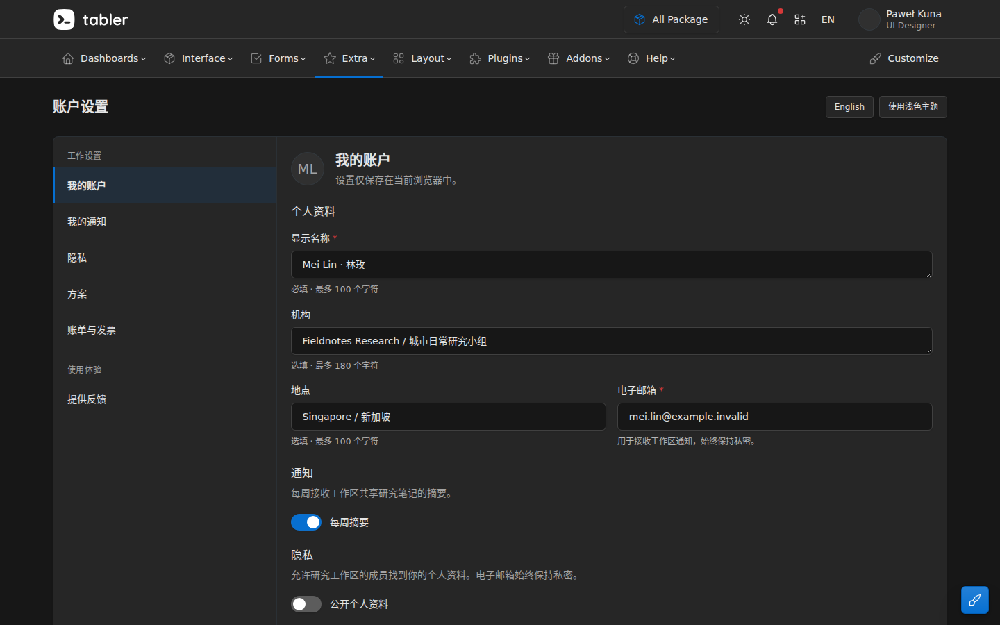
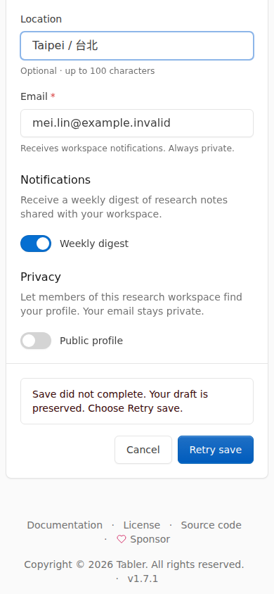

<!-- Derived navigation copy; never use as an original participant export. -->

> Repository navigation copy. The participant report is retained byte for byte in [FINAL.md.txt](FINAL.md.txt) and the workspace overlay archives. Only local artifact link destinations below are adapted for this repository.

# Fieldnotes settings completed

The supplied settings application now has a coherent profile, notification and privacy editing flow, with real validation, pending feedback, failed-save recovery, retry, cancellation and reload. The implementation retains **Tabler 1.7.1** and its original settings card, navigation, typography, surfaces, controls and theme system. Product changes are confined to `app/index.html` and `app/settings-controller.js`; the authoritative store and its validation rules are unchanged.

## What changed

- **Feedback stays with the action.** A persistent Tabler alert sits above Cancel and Save. Pending, success, failure, retry and newer unsaved edits have distinct, localized messages. Save and Cancel are disabled only during the non-cancellable save operation.
- **Validation identifies the actual field.** Store-provided errors use the existing invalid-control and feedback classes, `aria-invalid`, and associated error IDs. The first invalid field receives focus and is immediately revealed. A blur check cannot move the Save button during activation.
- **Submitted data and later edits remain separate.** A successful submitted snapshot does not overwrite newer input. The interface explicitly says when submitted changes were saved but subsequent edits still need saving. Failure retains the draft and the previously persisted value; retry saves the current draft. Cancel restores the last persisted settings.
- **Long bilingual values remain visible.** Name and organization use Tabler’s textarea family with a height-only content adapter. The specified long Chinese/English name wraps naturally and remains editable. Profile, notifications and privacy retain the source section hierarchy.
- **Narrow entry is usable.** The existing settings list becomes a Tabler collapse below the md breakpoint. Language and theme controls move into the source page-header action pattern. The peripheral floating customization button is hidden on narrow screens after it was observed covering email help.
- **Language and theme changes preserve the task.** Switching language updates labels, errors and status in place without reloading or discarding edits. Theme changes preserve values and use the existing theme system.
- **Feedback uses the source’s stronger theme roles.** Actual measurement found weak contrast in some default alert text/background pairs. Existing `text-*-emphasis` utilities improve those pairs without introducing a new palette or visual component.

The source comparison and actual adoption mapping are in [SOURCE-ADOPTION.md](artifacts/SOURCE-ADOPTION.md.txt). The evolving design decisions, observed defects and repairs are in [DESIGN.md](artifacts/DESIGN.md.txt).

## Verified result

The final automated run passed **13 scenarios** and retained **83 real captures**. A separate run passed six additional behavior checks. All browser activity used the owned local application and the unchanged store.

| Scope | Executed coverage |
|---|---|
| Primary layout and representative long content | English and Simplified Chinese, light and dark, at 1440×900, 1280×600 and 390×844 |
| Validation, pending, one failed save, retry, success, edits during pending, Cancel and reload | Every language/theme combination at 1280×600 and 390×844 |
| Keyboard-only path | Tab navigation, name editing, Save, failed save and Enter-to-retry through confirmed persistence; visible focus inspected |
| Notification/privacy preferences | Keyboard-operated switches, preserved failed draft, successful persistence and reload |
| Theme/language continuity | In-place switching with unsaved values and switches, including a language change while save was pending |
| Narrow navigation | Rapid section selection during expansion, source collapse completion, focused return, and 767/768px breakpoint behavior |
| Storage failure boundary | Unreadable existing browser data remains intact; saving is blocked rather than silently overwriting it |
| Runtime | No page errors or external requests in the final primary matrix; no horizontal document overflow in the tested viewports |

The final matrix’s source hashes match the delivered source. The unchanged store SHA-256 is `32139de23b4ad411c402620e84d5592f7ccfbcf68cece1a123946c29b63c2da0`.

Evidence is available in [results.json](artifacts/evidence/final-v5/results.json), [delivery-manifest.json](artifacts/evidence/delivery-manifest.json), and [VISUAL-REVIEW.md](artifacts/VISUAL-REVIEW.md.txt). Failed attempts, corrections, original command stdout/stderr, source references and exact image-tool returns remain in `evidence/`.

## Actual visual output

The desktop composition keeps the original settings family while making the identity and form hierarchy consistent.



At narrow width, failure remains visible beside its recovery action, and the draft stays available.



## Run the product

No installation or build is required. From the work package’s `app/` directory:

```bash
python3 -m http.server 4403 --bind 127.0.0.1
```

Use `/?theme=light&lang=en` or `/?theme=dark&lang=zh`. Add `&fail=once` to exercise one failed valid save and a successful retry in the same session. The verification server was stopped after inspection, as required by the run control.

## Scope and remaining limits

No unresolved functional blocker was observed in the tested settings path. The supplied upstream gallery navigation and demo chrome outside this settings task remain outside the runnable product contract.

The primary designer personally opened the original source render, baseline, all requested primary variant combinations, and representative final field, status, focus and return captures. Ordered screenshots and real runtime state checks establish sampled behavior; they do not establish uninterrupted natural-speed visual playback. Screen-reader announcement quality, real mobile software-keyboard behavior, other browser engines and whole-page accessibility certification were not tested.

Live public demo access was blocked, so the supplied official snapshot rendered with the pinned assets served as the actual viewed mature reference. No TLS checks were disabled. The independent research report and exact delegation records are retained in [research FINAL.md](artifacts/evidence/research/FINAL.md.txt) and [DELEGATION.json](artifacts/DELEGATION.json). Final product design decisions and assembled-output inspection remained with the primary agent.
