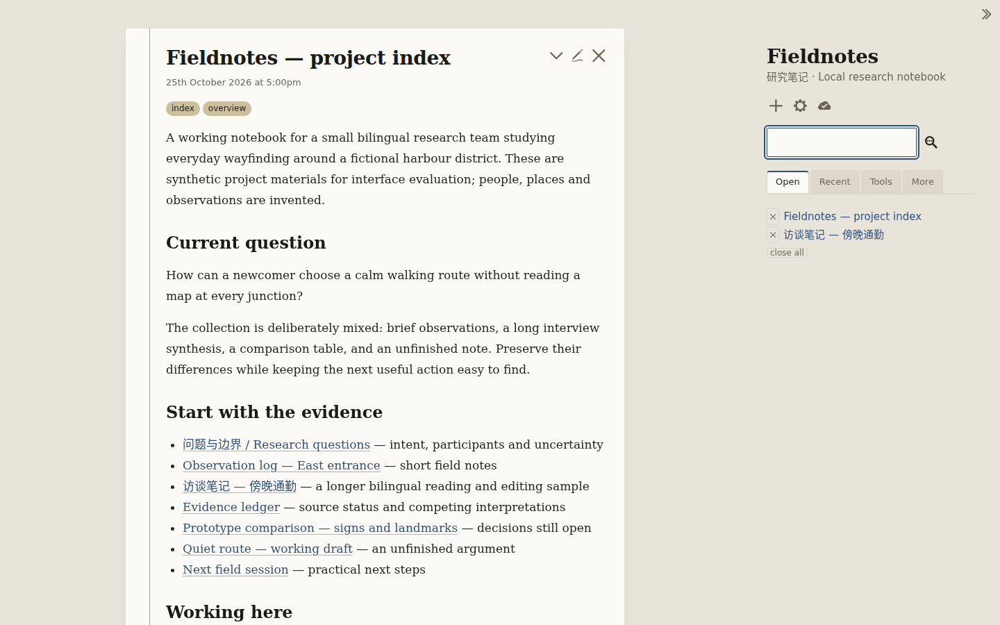

<!-- Derived navigation copy; never use as an original participant export. -->

> Repository navigation copy. The participant report is retained byte for byte in [FINAL.md.txt](FINAL.md.txt) and the workspace overlay archives. Only local artifact link destinations below are adapted for this repository; directory links lead to the complete-workspace reconstruction instructions.

# Fieldnotes — completed application

Fieldnotes now uses **Vanilla Paper 0.10.0** as its mature visual foundation: warm paper sheets, a restrained margin rule, serif reading, sans navigation and a ruled editor. The native TiddlyWiki store, linked-note navigation, drafts, search and filesystem persistence remain authoritative. All eight supplied notes are intact.



## Run the application

```bash
cd /workspace/scratch/e1cfe6e447ee/ui-study/active-worksets/w12-final-1130/app
PORT=4412 ./start.sh
```

Open **http://127.0.0.1:4412/**. The preview process used for verification has been stopped; the source and launcher are ready to run. Node 20 or newer is required, with no package install or remote service needed.

The initial state opens the project index and bilingual interview in Paper Day. Paper Night is available through the native Control Panel → Appearance → Palette. Simplified Chinese is available through Basics → Language. The rebuilt [offline export](artifacts/app/wiki/output/index.html) is supplementary; use the server path for the verified persistence workflow.

## Design and source decisions

I compared the supplied native foundation, Paper, and **Notebook 1.4.1** using source material and populated local trials. Notebook was a meaningful challenger: its centered 800px cards, bold sans headings and top task bar offer a different navigation and reading model. Paper better carries this project's editorial research identity across long reading and editing. This is a design judgment supported by the inspected implementation, not user preference evidence.

Paper's original layout, dimensions, typography, surface rules and day/night materials are retained. Supported options make note controls always visible and titles sticky. Four existing foreground tokens in each palette were strengthened using the source's own color token. Native quiet configuration removes note-transition travel.

Two narrow source repairs address observed problems: the reduced-motion rule now respects zero-duration transitions, and wide evidence tables scroll within narrow sheets. At 390px, an actual horizontal-wheel action moved the table 165px and exposed its final column. Table keyboard-scroll semantics remain unverified.

The exact adopted Paper revision is `031a78d4d4187128c632f8a647fa05408eddc700`; Notebook's trial revision is `465c832c885894ee3c97be76449cc524e1252eb0`. Both carry retained MIT notices. Paper has 54 byte-identical files and one original-identity stylesheet containing the documented repairs. All 8,823 native vendor files remain unchanged. No new image, font, animation engine, data store or W1/W2/W3 exception was introduced. [Source adoption and comparison](artifacts/SOURCE-ADOPTION.md.txt) records provenance and the [complete source diff](artifacts/evidence/paper-final.patch.txt).

## What was verified

- Read the complete bilingual interview, follow Evidence ledger and return.
- Edit English and Chinese passages, save through native controls, verify the actual filesystem write, then reload and confirm the same text.
- Cancel an edit and confirm the original note survives reload.
- Use keyboard search and reach the note editor with the keyboard.
- Inspect reading and editing in both palettes at 1440×900, 1280×640 and 390×844; inspect representative Chinese UI conditions.
- Check normal/reduced-motion settings, repair the observed duration conflict, and recheck the resulting state.
- Restore all eight original note files byte-for-byte and confirm the two-note start state on reload.

The successful native journey reported no page JavaScript errors and no external requests. Actual screenshots were personally opened, including the final delivered state. Earlier failed selectors, the incorrect initial Notebook configuration, the reduced-motion defect and the narrow-table defect are retained with their corrections.

Representative evidence: [dark reading](artifacts/evidence/captures/verification-v3/final-dark-read-1440.png), [narrow editing](artifacts/evidence/captures/verification-v3/final-light-edit-390.png), [Chinese dark editing](artifacts/evidence/captures/verification-v3/final-zh-dark-edit-390.png), and [repaired narrow ledger](artifacts/evidence/captures/table-repair/ledger-right-390.png).

## Evidence and limits

[VISUAL-REVIEW.md](artifacts/VISUAL-REVIEW.md.txt) maps inspected views and distinguishes static images from controlled episodes. [Native verification log](artifacts/evidence/captures/verification-v3/verification-log.json), [final integrity record](artifacts/evidence/source-integrity-final.json), [design decisions](artifacts/DESIGN-DECISIONS.md.txt) and [integration decision](artifacts/INTEGRATION-DECISION.md.txt) retain the supporting detail.

No natural-time playback, full accessibility audit, screen-reader session, hardware phone/IME, Firefox/Safari testing or injected network-failure recovery test was performed. The narrow evidence table requires horizontal navigation. No blocking defect remains in the exercised core paths; these limits remain open.

One independent research dispatch failed at the host's agent-thread limit. Its exact request and actual failure are in [DELEGATION.json](artifacts/DELEGATION.json); it supplied no findings. The primary completed source research, implementation and final visual inspection. The actual substantive close and preparation timestamp are recorded separately in RUN-RESULT.json.
