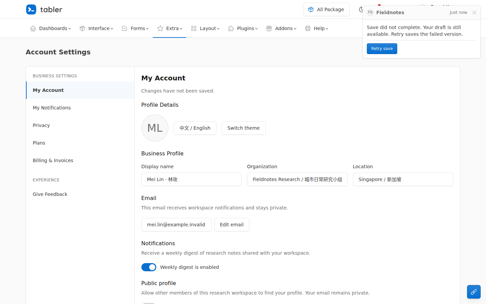

<!-- Derived navigation copy; never use as an original participant export. -->

> Repository navigation copy. The participant report is retained byte for byte in [FINAL.md.txt](FINAL.md.txt) and the workspace overlay archives. Only local artifact link destinations below are adapted for this repository.

# Fieldnotes settings: completed save-feedback integration

The assigned T4 integration is complete. The existing settings application now uses the selected native Tabler toast for pending, saved, failed and invalid outcomes, with explicit retry of the failed snapshot and preserved newer edits.

## Run the application

No build or dependency installation is required.

```bash
cd /workspace/scratch/708e8b7f118e/ui-study/worksets/w17/app
python3 -m http.server 4417 --bind 127.0.0.1
```

Open [the light English view](http://127.0.0.1:4417/?theme=light&lang=en) or [the dark Chinese view](http://127.0.0.1:4417/?theme=dark&lang=zh). Add `&fail=once` to exercise a one-time save failure and Retry. The dedicated verification server was stopped after testing, as required.

## What changed

| Product file | Result |
| --- | --- |
| [index.html](artifacts/app/index.html) | Adopts the native action-bearing toast, its full MIT notice, the prescribed top-right container and associated Tabler field-error slots. |
| [settings-controller.js](artifacts/app/settings-controller.js) | Coordinates store events, concise form summaries, actual field errors, focus recovery and stale-result suppression. |
| [save-notification.js](artifacts/app/save-notification.js) | Renders the authoritative save states and retries the exact failed snapshot through the existing store. |

A successful save reports the actual browser-local outcome and saved time. It leaves later edits in the form and marks those edits as unsaved. A failed write preserves the previous stored value and the draft. Retry saves the failed version explicitly. Dismissal changes only feedback; it does not cancel persistence or discard input. Invalid submissions identify the actual first invalid field and expose associated localized errors.

The source's 350px shell, avatar/identity/time/close header, body spacing, separated error action, small primary button, typography, border, shadow and native Toast transitions remain intact. The frozen placement and source choice were retained. The [source manifest](artifacts/SOURCE-MANIFEST.json) preserves Tabler 1.7.1, the tagged revision and the separate deployed HTML snapshot identity; the deployment commit remains unknown.

## Verified result

The main agent independently ran **203 passing assertions** across 1440×900, 1280×600 and 390×844 in light/en and dark/zh, including stale-event and dismiss-during-pending cases. All six matrix conditions had zero JavaScript page errors. The scoped integrator separately passed **156 assertions**.

The checks reached real browser storage and covered valid save, pending edits, failure preservation, failed-snapshot retry, reload persistence, validation, keyboard focus, native close, no auto-hide, containment and source-shell retention. Initial form geometry matched the preserved baseline in every condition. The store, Tabler CSS and unrelated controller handlers remained unchanged. A separate reduced-motion run reached a saved result with the native toast transition measured at `0s`.

I personally opened **32 actual images**, including the selected source, baseline, all 18 settled final error/validation views, sampled pending/success states and the inherited-overlap comparison. That visual review is separate from the assertion counts.



## Material limits

- **Header access while feedback is visible:** the prescribed top-right toast covers several right-side header utilities, and at 390px it also covers the center of the navigation toggle. Its native close stays reachable. Independent hit checks confirmed the covered header controls become reachable after dismissal.
- **Inherited mobile overlap:** the existing Customize floating button covers part of Save's right edge at 390px. Baseline and integrated geometry and hit results are identical; Save's center and keyboard activation remain usable. The protected unrelated control was left unchanged.
- **Evidence boundary:** real-device touch, auditory screen-reader behavior and uninterrupted natural-speed playback were not directly evaluated. Ordered captures and actual timer-driven interactions were inspected; the retained videos are not claimed as viewed playback. Broader upstream gallery routes remain outside this assignment.

No defect was observed in the assigned notification, validation, persistence or focus integration. The two visible placement limits above remain recorded.

## Evidence and handoff

- [VISUAL-REVIEW.md](artifacts/VISUAL-REVIEW.md.txt) — independent source, whole-product and temporal-evidence judgment, including exact limits.
- [Main behavior report](artifacts/evidence/main-check-002/report.json) and [neighbor comparison](artifacts/evidence/neighbors/results.json) — actual assertions, storage readbacks, capture brackets and hit results.
- [INTEGRATOR-REPORT.md](artifacts/INTEGRATOR-REPORT.md.txt) — bounded implementation, source retention and scoped checks.
- [DESIGN-RECORD.md](artifacts/DESIGN-RECORD.md.txt), [DELEGATION.json](artifacts/DELEGATION.json) and [FINAL-SOURCE-DIGESTS.json](artifacts/FINAL-SOURCE-DIGESTS.json) — current decision, actual coordination exports and final source identities.

Original failures are retained: two child-capacity responses, the main capture-script path error, the integrator's Playwright argument error and the acquired source's optional banner certificate failure. Corrected runs and final observations remain separate from those attempts.

