# Independent-review gallery

These are unchanged frames captured during the three anonymous product reviews.
Conditions were added after the reports were frozen: A is the published method,
B adds scope judgment, and C is the integrated mechanism. Each family uses the
same reviewer task content; application-specific content and capabilities can differ.
These are sampled states, not a pixel score or a complete interaction verdict.

[Observed results and limits](RESULTS.md) · [Exact image provenance](gallery-provenance.json)

## T1 · Leafnote — shared type and density

Comfortable reading of the common long English/Chinese note.

[Original independent report](reviews/T1/original/REVIEW.md.original.txt) · [Condition map](reviews/T1/unblinding.json)

### Desktop · 1440 × 900

| A · published | B · judgment | C · integrated |
|---|---|---|
| 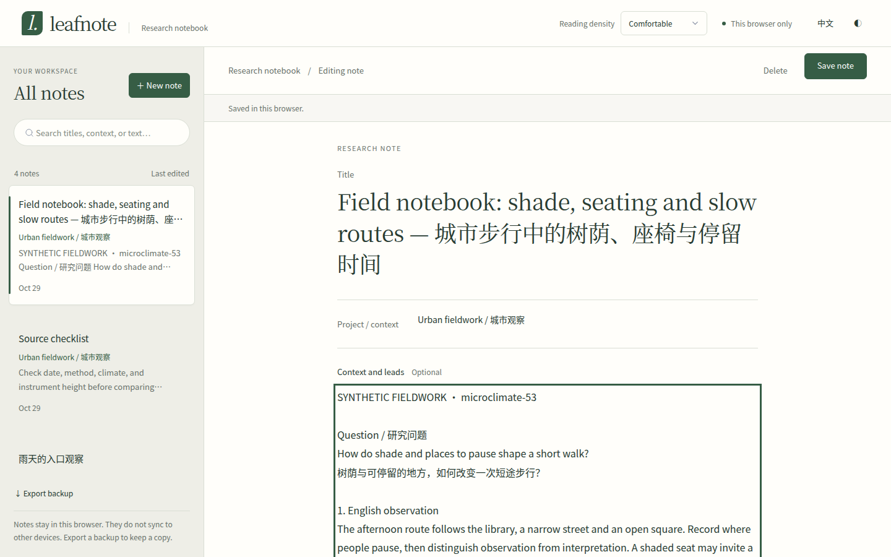 | 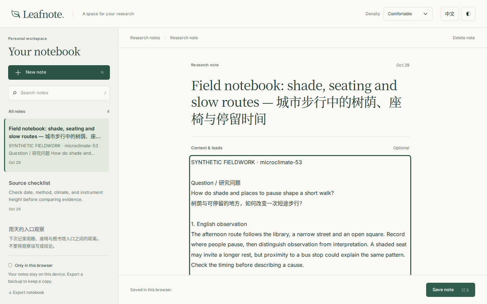 | 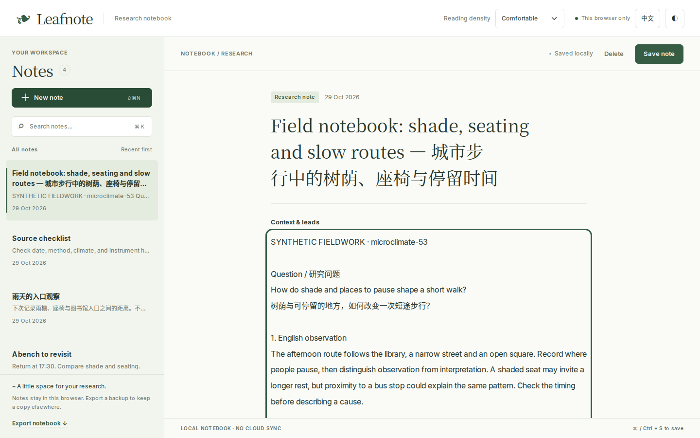 |

### Narrow · 390 × 844

| A · published | B · judgment | C · integrated |
|---|---|---|
| 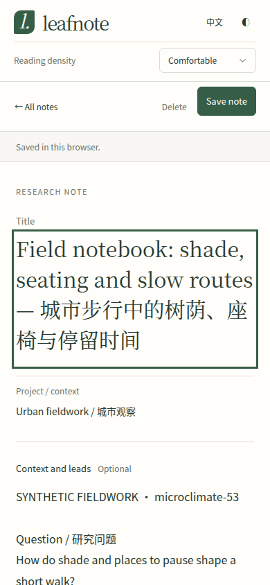 | 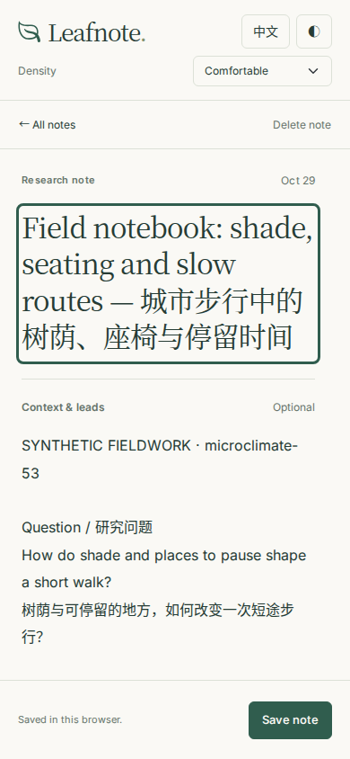 | 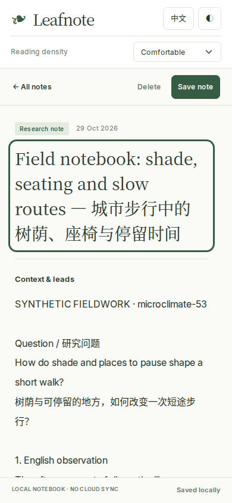 |

Open an image for its full captured dimensions. The source and raw review evidence can be restored using [REPLAY.md](REPLAY.md).

## T2 · Meridian — source reading during output

Source open while the answer unfolds; all related recovery gaps remain in the report.

[Original independent report](reviews/T2/original/REVIEW.md.original.txt) · [Condition map](reviews/T2/unblinding.json)

### Desktop · 1440 × 900

| A · published | B · judgment | C · integrated |
|---|---|---|
| 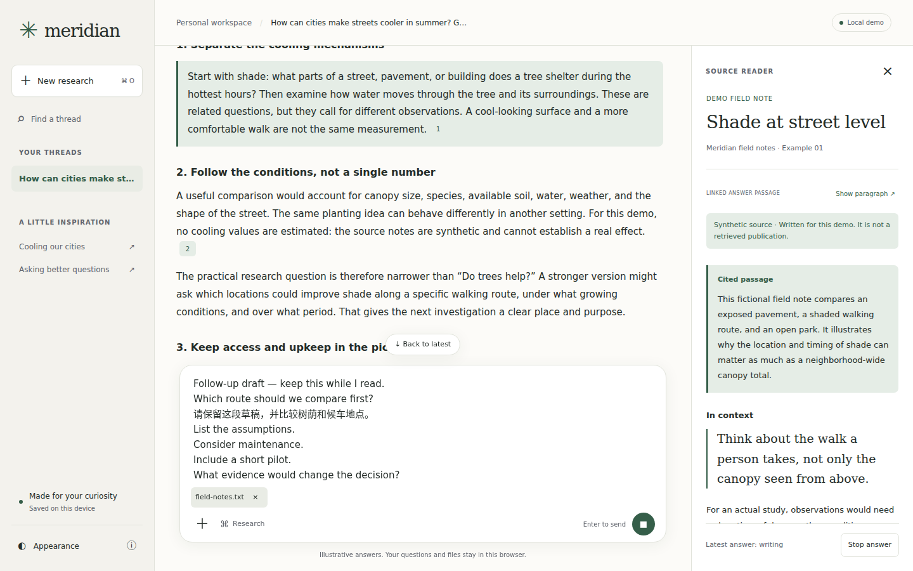 | 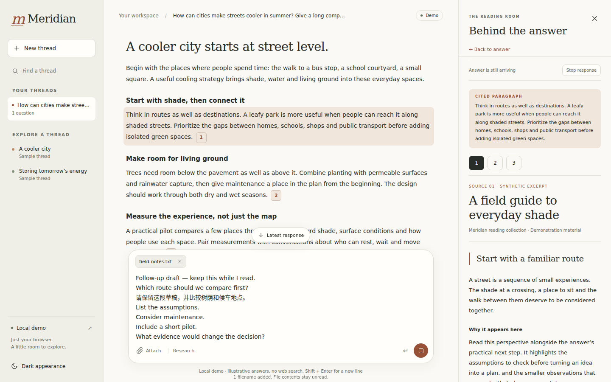 | 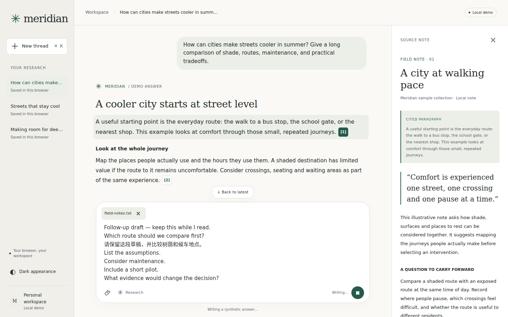 |

### Narrow · 390 × 844

| A · published | B · judgment | C · integrated |
|---|---|---|
| 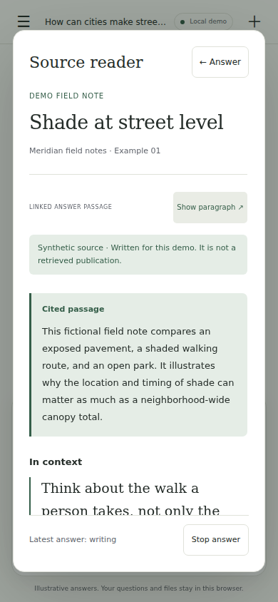 | 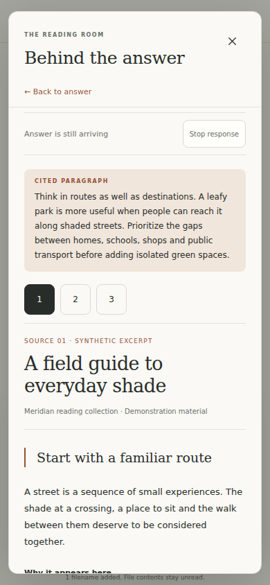 | 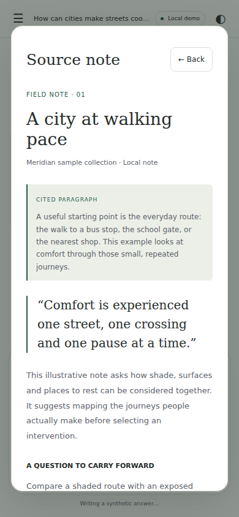 |

Open an image for its full captured dimensions. The source and raw review evidence can be restored using [REPLAY.md](REPLAY.md).

## T3 · Fieldnote — collection continuity

Three saved notes in the same product after the collection increment.

[Original independent report](reviews/T3/original/REVIEW.md.original.txt) · [Condition map](reviews/T3/unblinding.json)

### Desktop · 1440 × 900

| A · published | B · judgment | C · integrated |
|---|---|---|
| 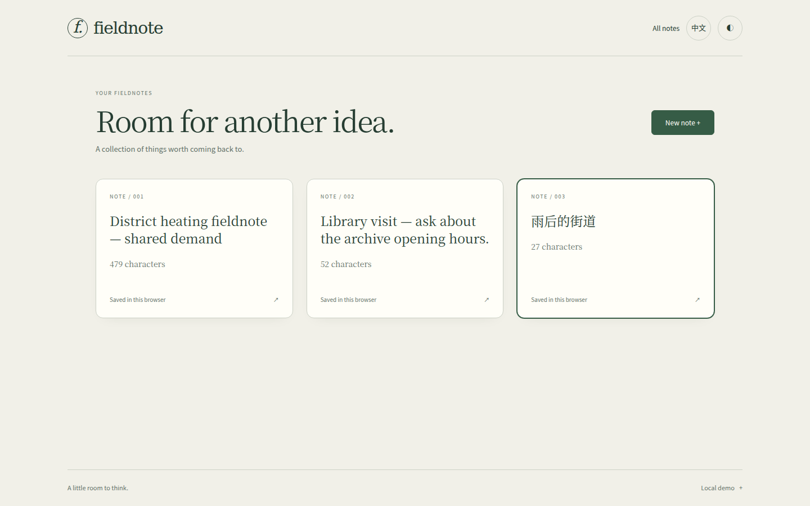 | 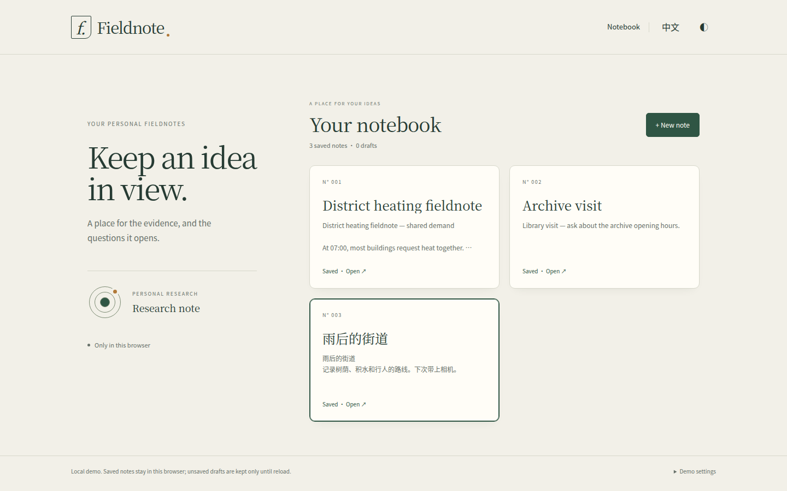 | 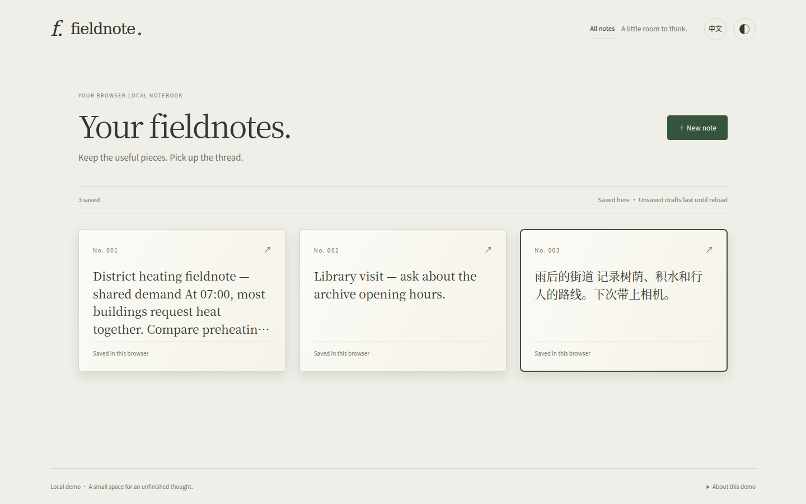 |

### Narrow · 390 × 844

| A · published | B · judgment | C · integrated |
|---|---|---|
| 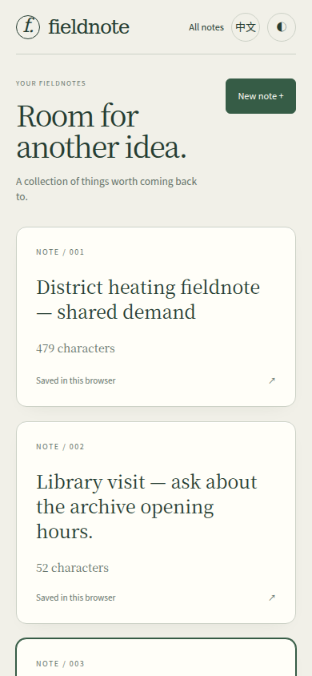 | 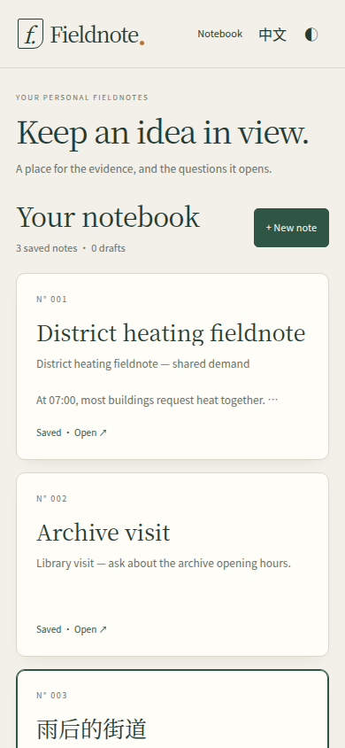 | 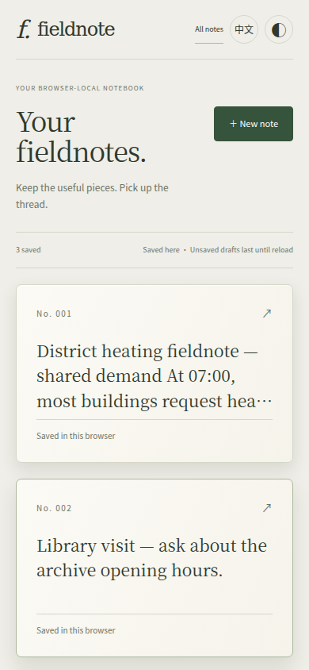 |

Open an image for its full captured dimensions. The source and raw review evidence can be restored using [REPLAY.md](REPLAY.md).
