# Actual application gallery

These are unchanged captures from the independent post-freeze product reviews.
**A** is v1.18.0; **B** is the registered candidate before the separately disclosed
worked-example correction. Images show specific observed states, not universal
quality or human acceptance. The review browser used 1440×900 and 390×844 viewports;
some mobile images capture the full scrollable document at that viewport width.
Open an image to inspect its original dimensions. See [results](RESULTS.md) and
[source review](SOURCE-REVIEW.md) for the distinct evidence claims.

## T1 — collection workspace

Both support the exercised collection/search/save/read/return loop. The independent
review found stronger editorial coherence in A and larger, easier-to-read list
text in B. B adopts a broader actual page/system foundation; that fact does not
decide the visual comparison.

| A — T1-p6 | B — T1-n2 |
|---|---|
| 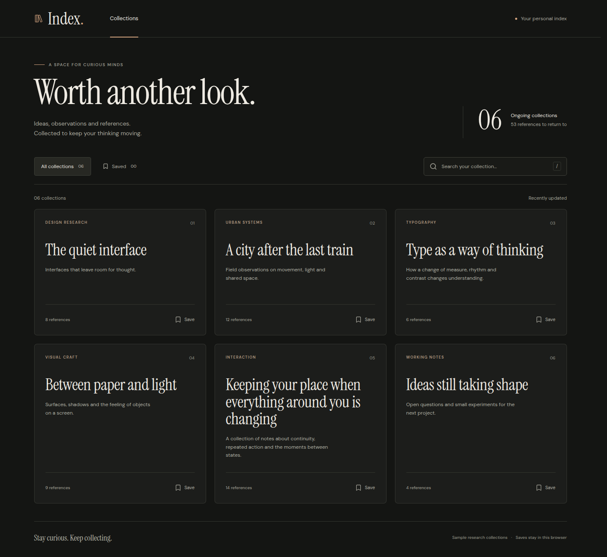 | 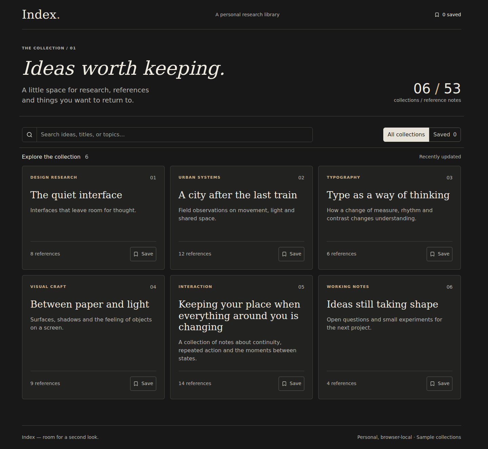 |
| 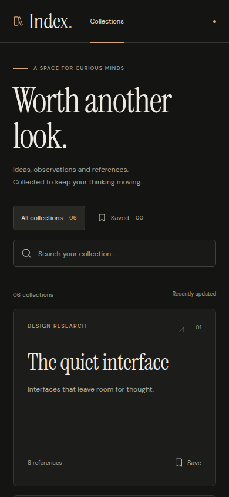 | 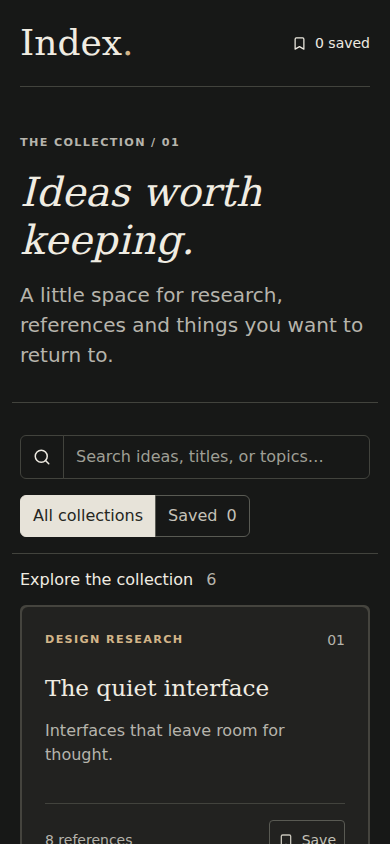 |
| 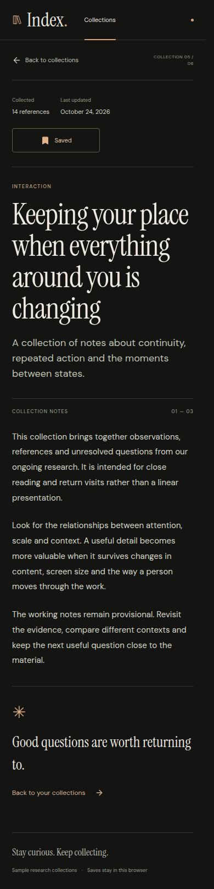 | 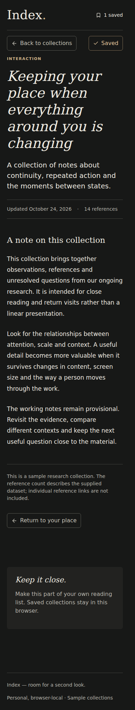 |

## T2 — continuous card and long-note reading

Both preserve identifiable source motion mechanisms and the exercised save/failure
paths. A's bounded vanilla adaptation provides clearer card text and more desktop
reading space in this observation. B retains direct keyboard/drag interaction,
but has visible card-text softness and adds a React build. These static views do
not establish a natural-speed motion ranking.

| A — T2-v9 | B — T2-k4 |
|---|---|
| 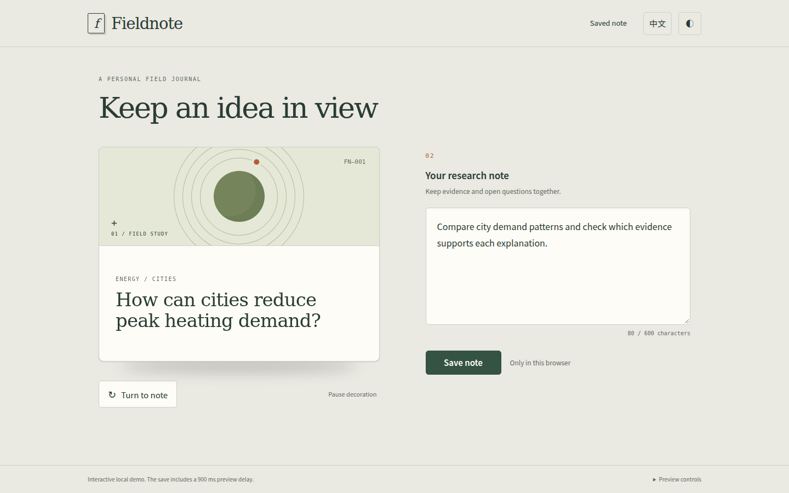 | 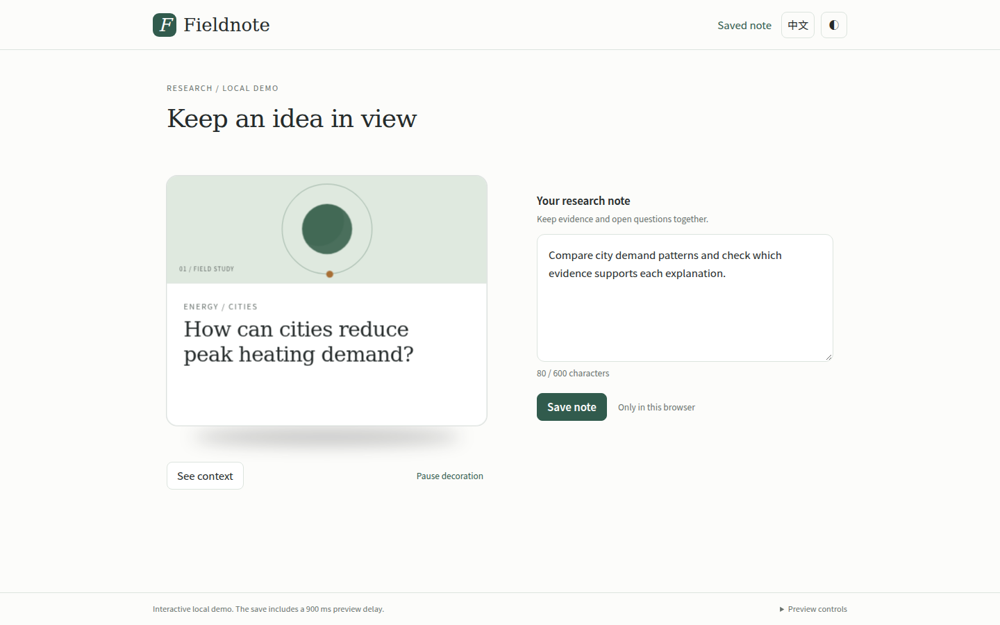 |
| 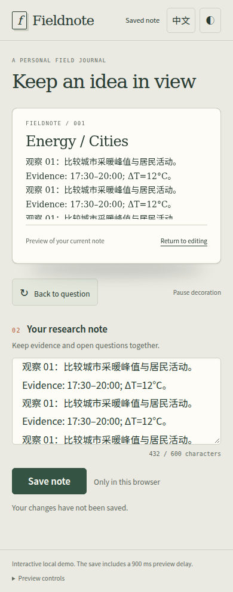 | 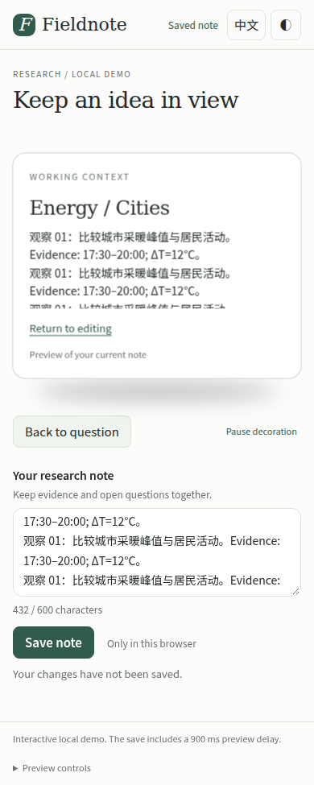 |
| 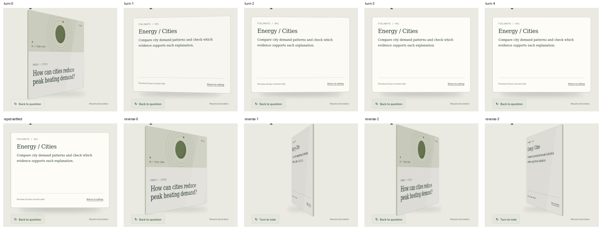 | 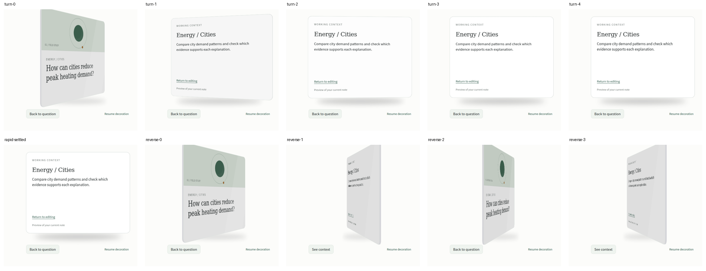 |

The contact sheets contain ordered samples, not continuous playback. The original
frames, rAF observations and available WebM recordings remain in the evidence ZIP.
Neither saved video was reviewed at natural speed.

## T3 — inherited system and a local conflict extension

Both preserve the accepted editor and use the specifically authorized mark/local
comparison scope. B synchronizes the continuing remote update and returns focus
to editing; A's notification updates before the compared text, and selection leaves
focus on a hidden action. A's more compact mobile comparison nevertheless keeps
both versions closer together. B's second version remains reachable through actual
outer scrolling, with greater navigation effort.

| A — T3-r8 | B — T3-c7 |
|---|---|
| 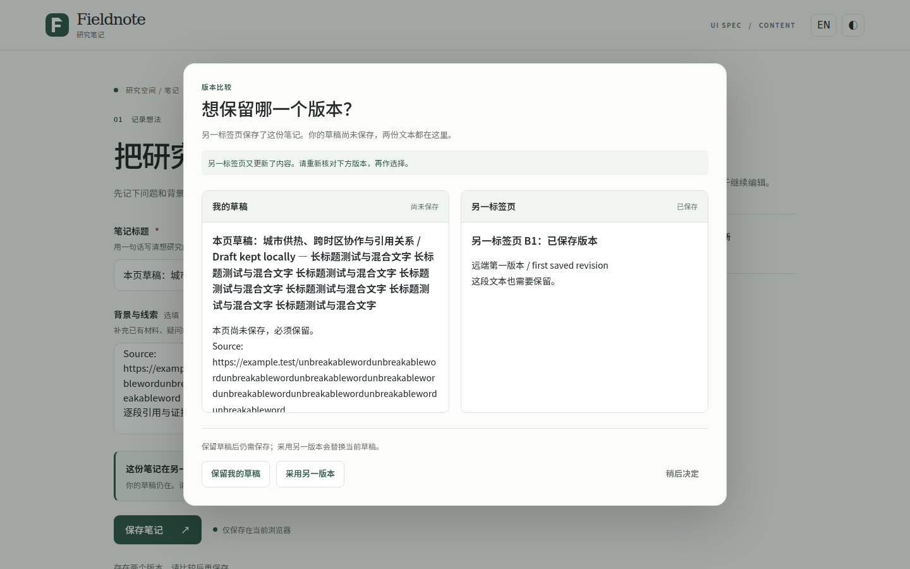 | 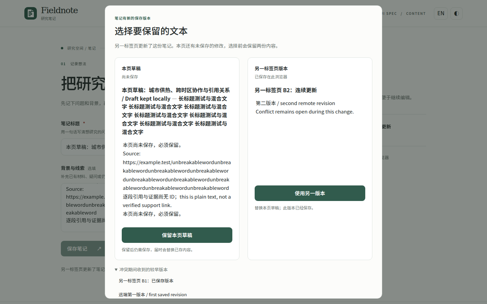 |
| 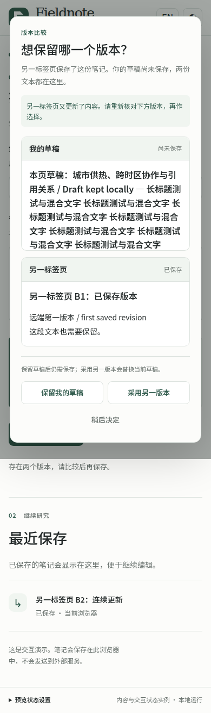 | 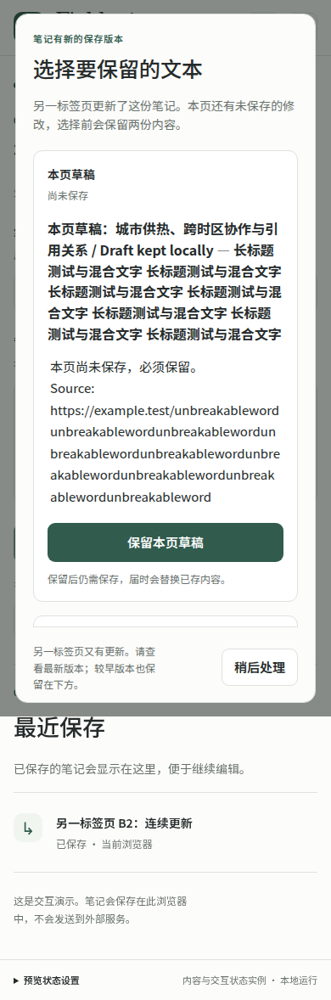 |
| 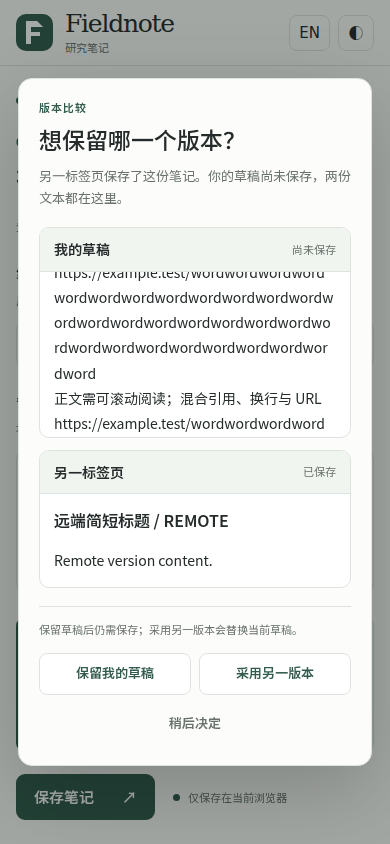 | 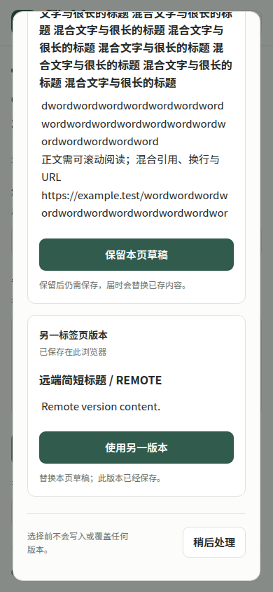 |

The reports and actual state records qualify the screenshots: the A update path
has a protective second check and did not demonstrate data loss. Images alone
cannot establish storage correctness, focus sequence or exception authorization.
