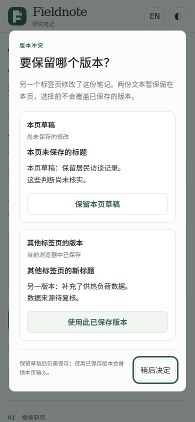
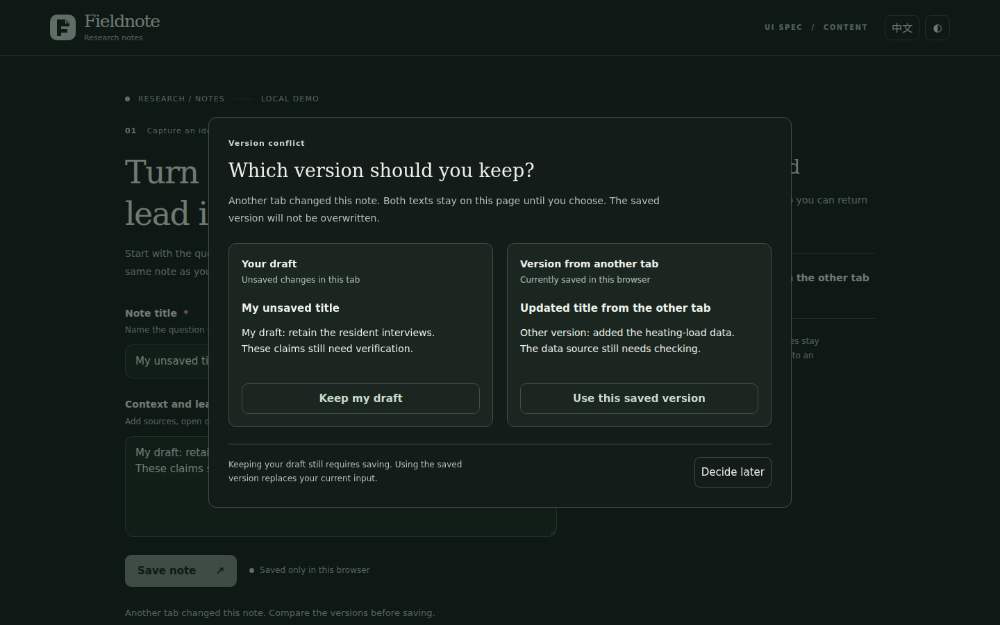
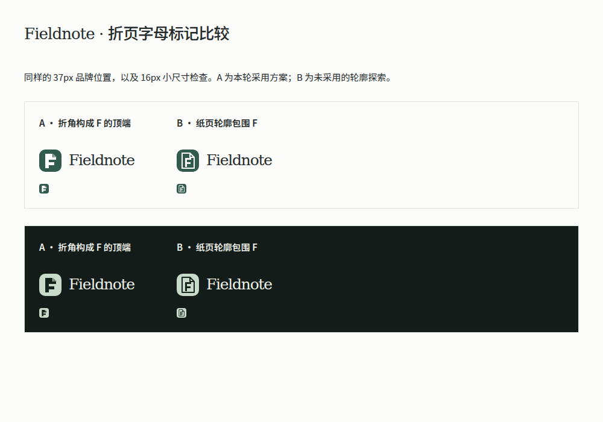

# Final-runtime identity follow-up

## Scope and identity

T3-m5 is a separately registered fresh Agent execution of the exact final v1.19.0
37-file runtime. The [registration](registration.json) was written before dispatch.
The task uses the same T3 starter and requirements, with an added instruction to
consult the relevant worked examples. It follows the two narrowly qualified
identity-example premises recorded in [the final delta](../final-runtime-delta.json).
The six original A/B applications and their conclusions are unchanged.

The [output index](outputs/archive-index.json) identifies 25 application/resource
files and 58 saved evidence files. The coordinator verified that all 37 assigned
runtime files still matched the released runtime before freezing the output.
No application repair was made after handoff. Extract the whole
[application ZIP](outputs/application.zip), retain `resources/`, and run from its
`app/` directory with `python -m http.server 4317 --bind 127.0.0.1`.

## Actual observed implementation scope

The participant explicitly read the brand-asset, wordmark/everyday-reading and
truthful-note worked examples. Its saved decisions identify the task's actual
W1 permission for the folded-page F, keep the accepted editor/brand position,
and do not extend that permission into an original page. It compares two editable
mark variants at 37px and 16px on both themes, retaining a simpler F contour.
The same asset supplies the small favicon; the original page and font stack remain.

The comparison dialog is scoped as W3: the accepted status/recent-save mechanisms
cannot show both complete texts, and the task explicitly permits that missing
local presentation. The participant records the existing design's responsibility,
considers Bootstrap Modal, and does not pretend native dialog semantics alone
provide visual maturity. Existing color, type, boundaries and controls remain the
foundation. No extra exception or new authorization lifecycle is introduced.

Placeholder text is 13px while entered text remains 15px; the original control
proportions are retained. This differs from the 14px choice in the matched T3
applications and is not relabeled as identical output. The task requests a smaller
guidance role, rather than prescribing 14px. The future quotation-support view
remains a researched proposal because title/free-text records do not contain its
required identifiers or support relationships.

## Saved checks and direct visual observation

The participant reports eight viewport/language/theme matrix groups plus a
race/long-content group and an actual Storage-fault group. Its verification record
lists save/reload, real two-tab conflicts, both choices, defer/Escape, failure/retry,
continuing edits, remote updates/deletion and recovery from malformed storage.
The record explicitly says the eight matrix iterations completed before a later
collapsed-history assertion stopped that run. Subsequent scoped checks corrected
test reading/injection assumptions; the archive retains the scripts and explanation.
This is not described as one uninterrupted successful test run.

The coordinator read `DESIGN-NOTES.md` and `evidence/verification.json`, and opened
the following three original screenshots. The short-content mobile comparison
shows both text roles, choices and the focused defer action within the captured
view; the desktop dark comparison preserves the two-column relationship; the
mark sheet makes the 37px/16px tradeoff visible. These views support those concrete
observations. They do not independently replay all participant behavior assertions.

| Mobile comparison | Desktop dark comparison |
|---|---|
|  |  |

The A/B labels in the mark sheet identify the two artwork variants, independently
of the main study's method labels. Full source, research, scripts and additional
states are in [participant-evidence.zip](outputs/participant-evidence.zip).

## Precise remaining limits

Unresolved conflict copies remain in page memory. Refreshing or closing the page
does not restore that unsaved conflict draft; the UI accurately says the copies
are retained on this page. This is a real difference from the two original T3
outcomes and is preserved as a limitation. The local saved version remains in
localStorage. There is no permanent version history, automatic merge or line diff.

Web Locks coordinate only cooperating same-origin pages; fallback read-before-write
checks do not constitute cross-process atomic transactions. Tests used the supplied
Chrome and simulated viewports, without real touch/IME, screen-reader speech,
cross-browser or independent human understanding checks. The coordinator's review
is a source/screenshot follow-up, not a fourth anonymized product comparison.

This execution shows that the final complete instructions can support actual
system inheritance and the already authorized local identity/extension work. It
does not independently test a 3D production pipeline, W2, refusal of unauthorized
originality, or a causal effect of the two example edits. Those boundaries remain
explicit in the [main results](../RESULTS.md).
