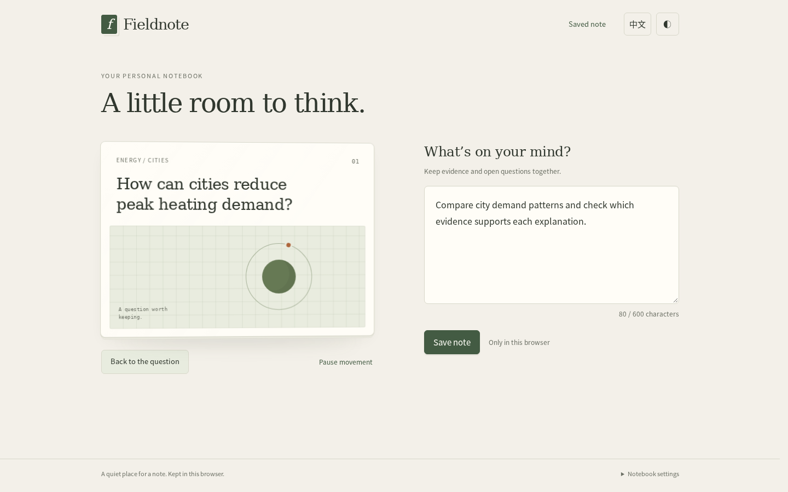

# Same-SPEC correction after independent review

**The specific early keyboard-focus failure is reproduced in the original C
application and corrected in the separate continuation under both tested sizes.**
The nine original run endpoints remain unchanged. This is an observed repair
after additional feedback and an instructed 10-minute extension, not another
comparative result or evidence that C generally outperforms the other methods.

## Why execution continued

The original T2 review found that A/P8 and C/L6 immediately exposed the target back
face to keyboard navigation while the card was still facing forward. The frozen C
endpoint therefore retained a gap within its existing continuous-interaction
responsibility. A separate copy of that exact endpoint received the concrete
failure, using the same frozen 37-file C runtime. No new formal SPEC or approval
gate was introduced. The [plan](continuation-plan.json) records the boundary.

The implementation separates motion intent from current visual orientation. It
uses the actual rotation matrix to update semantic exposure, temporarily excludes
both faces near the edge, rechecks orientation before keyboard navigation, and
moves focus to the stable flip button when the focused face leaves view. Only
`app.js` and the application README change; the HTML and CSS remain byte-identical
to the original C endpoint.

## Participant checks and independent checks

The participant records 166 assertions, 2,575 timed post-animation-frame samples,
actual accessibility-tree observations, and targeted native-storage failure/retry
checks. Those are retained as participant evidence. They are not an independent
quality score and are not added to the original comparative totals.

The independent reviewer then operates the old and repaired applications without
reading the participant's assertion list or implementation explanation. It uses
actual mouse/keyboard input, orientation matrices, aria/inert, active focus and
screenshots at 1440×900 and 390×844, English/light, DPR 1.

| Operation | Original C/L6 | Separate repaired C copy |
|---|---|---|
| Click flip, wait 45ms, Shift+Tab | Both sizes enter invisible `preview-note` while the card is nearly front-facing | Both sizes keep the back inert/hidden and focus the visible theme button |
| Turn from the back toward the front | The still-visible back is closed immediately | Visible back remains reachable; focus moves to the flip button when it turns away |
| Reverse after crossing the midpoint | Final front face is correct | Final front face and focus are correct, without an observed instantaneous reset of the matrix |
| Reduced-motion preference | Visible back is directly reachable | Visible back remains reachable; no active animation at the sampled settled state |

The early state reads occur approximately 57–61ms after the actual click. In the
desktop comparison, the original matrix component is +0.999334 and the repair is
+0.999335: both cards still nearly face forward, but their focus destinations differ.
The captures follow these state reads and are not exact synchronized frame pairs.

| Original C: invisible back receives focus | Repair: visible theme button receives focus |
|---|---|
|  |  |

The [independent review](continuations/T2-k2/review/review.md) preserves the exact
operations, original measurements, screenshots and source fingerprints. It also
records a few isolated near-edge samples where matrix and semantic attributes
differ until the next sample. Focus stays on visible controls in those records.
This closes the specified reproducible keyboard failure; it does **not** establish
strict same-frame synchronization at every instant. The independent observations
qualify the participant's zero-mismatch result rather than being discarded.

## Reproducibility and remaining scope

[The continuation archive](continuations/T2-k2/archive-index.json) preserves the
original endpoint as its initial source, the repaired final source, four actual
messages, source snapshots, referenced-media snapshots and the recorder actually
used. [Received relays](continuation-received-relays.jsonl) identify the actual
outward texts. Referenced media is frozen by the post-study recorder described in
[INSTRUMENTATION.md](INSTRUMENTATION.md); original comparative messages are not
retrospectively rewritten.

The independent continuation review does not repeat the full storage, long-text,
language or theme suites. It does not remove the original product's long-note
return-button tradeoff. Natural-speed perceptual playback, real-device behavior,
screen-reader speech and other browsers remain unverified. Application files and
the original comparison report remain unchanged throughout independent review.

This is a concrete example of a discovered quality gap influencing further work
within the same responsibility, with its repair checked separately and its limits
preserved. It cannot isolate whether the disclosure method caused that behavior.
