# 可观察设计执行｜独立产品审阅画廊

这里展示独立审阅中实际打开查看过的原始截图。图片未经拼接、重绘或美化；点击可查看原图。画廊用于观察具体产品关系，完整结论与失败记录保留在各任务的原始审阅报告中。

审阅者先运行匿名产品并记录观察，再检查必要源码；方法映射未随产品输入提供。以下映射在审阅完成后公开，来自 [review-input-plan.json](review-input-plan.json)。

| 条件 | 方法范围 | T1 匿名产品 | T2 匿名产品 | T3 匿名产品 |
|---|---|---|---|---|
| A | 完整 v1.17.0 与共同宿主沟通要求 | T4 / T1-s8 | P8 / T2-s8 | D5 / T3-s8 |
| B | A 加入关键设计事件可见性指导 | R7 / T1-v5 | N3 / T2-v5 | K4 / T3-v5 |
| C | 完整冻结的 v1.18.0 候选，进一步连接实际品质兑现与修正 | M2 / T1-k2 | L6 / T2-k2 | A9 / T3-k2 |

三种条件均已有自适应 SPEC 粒度与专业设计方法。比较边界见 [实验方案](PROTOCOL.md)，不能将一次产品实现之间的差异单独归因于方法。

## T1｜集合工作台

下图均为桌面 **1440×900** 或手机宽度 **390×844**、DPR 1 的初始列表。R7 使用隔离 Vite 缓存后重新运行的原始截图；最初缓存冲突导致的白屏与诊断记录仍保留在归档中。

### 桌面构图

| A · T4 | B · R7 | C · M2 |
|---|---|---|
| 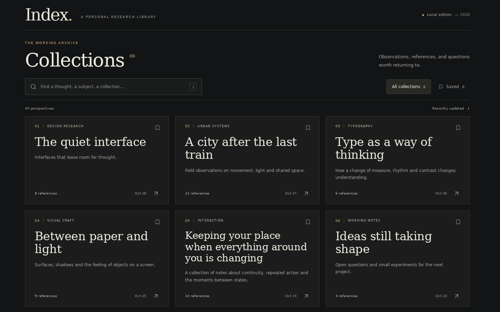 | 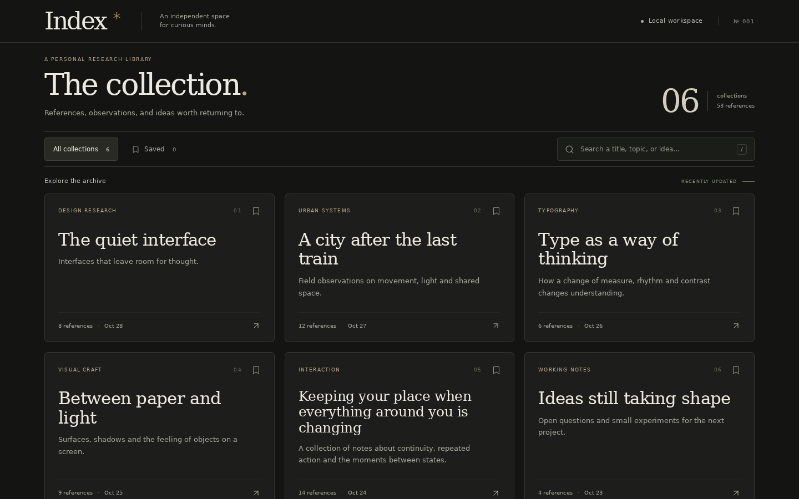 | 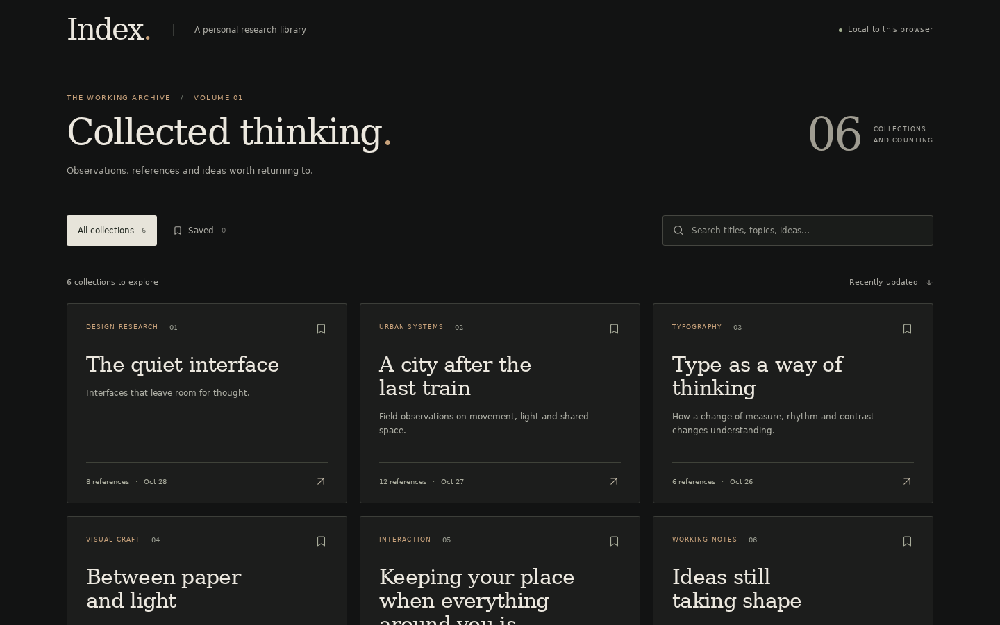 |

### 手机宽度的内容节奏

| A · T4 | B · R7 | C · M2 |
|---|---|---|
| 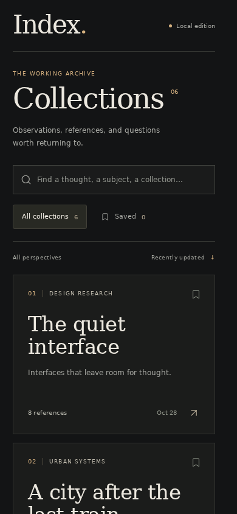 | 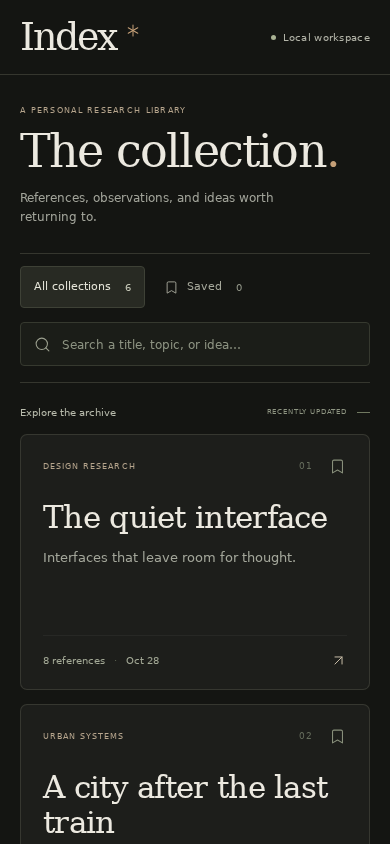 | 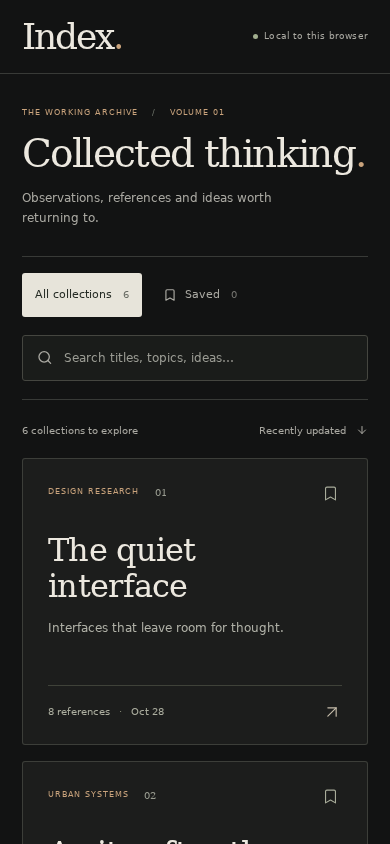 |

[独立审阅](reviews/T1/review.md)观察到 T4 桌面内容更早进入首屏、R7 手机标题更紧凑、M2 的本地范围与保存状态说明更直接；核心搜索、保存、阅读及返回路径均形成可用结果。这些差异没有集中在同一产品上，审阅没有给出总体排名。

[完整归档入口](reviews/T1/README.md)包含首次感知记录、失败诊断、行为测量及原图。 [逐图观察范围](reviews/T1/evidence-manifest.json)区分已捕获与已实际查看；静帧和交互测量不证明自然速度动效品质或真实设备性能。

## T2｜卡片连续交互

以下九图均为 **1440×900、DPR 1、英文、浅色**，来自原冻结产品的独立审阅。三组使用同样的初始笔记文字。图片尺寸相同，各产品卡片本身的尺寸并不相同；[独立审阅](reviews/T2/review.md)与[测量摘要](reviews/T2/measurements.json)确认的是每个产品各自正反面停稳后的外框位置和尺寸一致。

### 正面构图

| A · P8 | B · N3 | C · L6 |
|---|---|---|
| 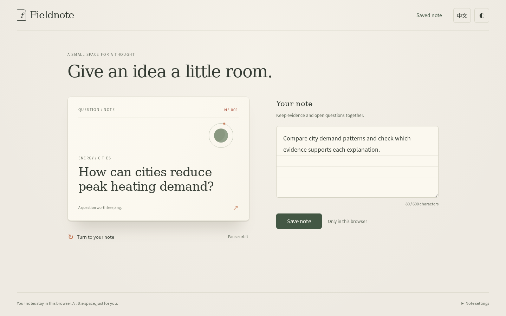 | 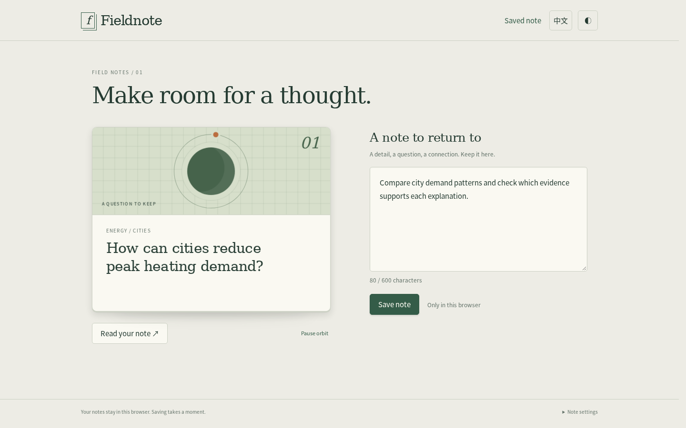 | 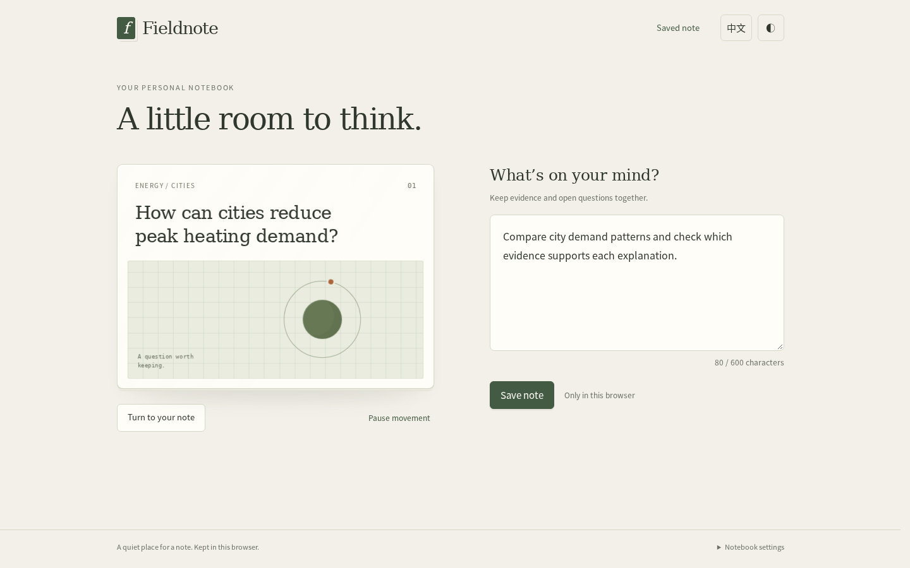 |

P8 把小型轨道图形放在问题文字上方，输入区使用横线；N3 把网格与轨道作为卡片上部独立区域；L6 将问题文字置于网格图形之前。这里保留三种实际构图，未以风格差异推导方法排名。

### 背面阅读

| A · P8 | B · N3 | C · L6 |
|---|---|---|
| 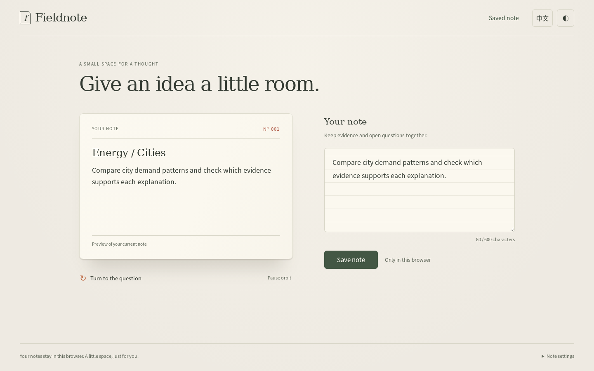 | 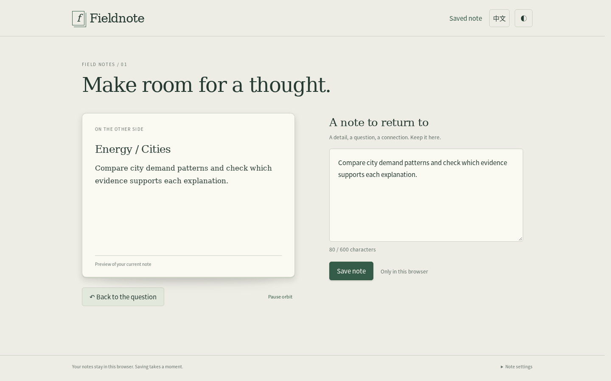 | 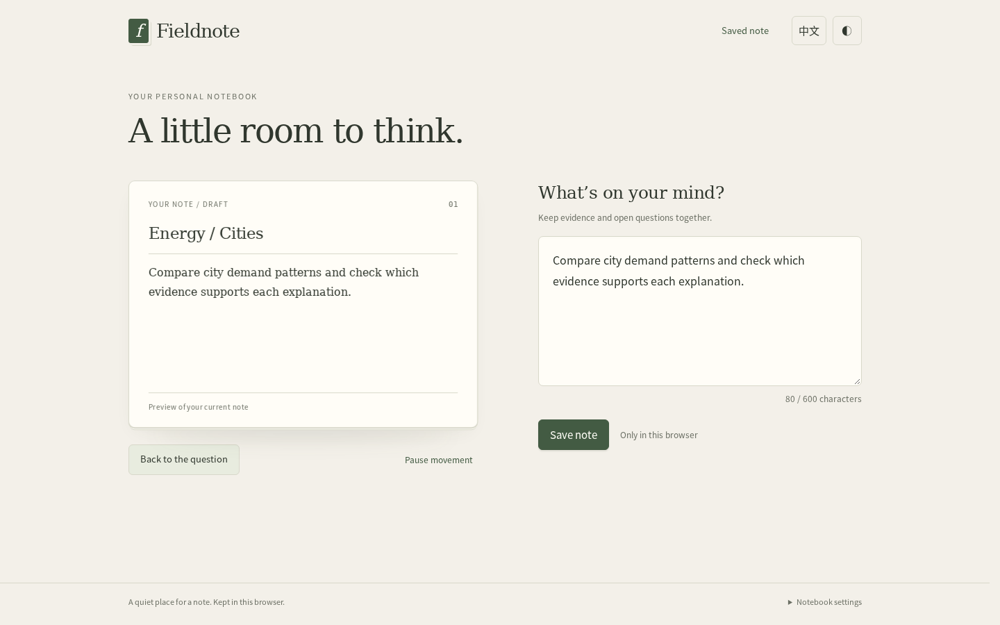 |

三者均保留了编辑、翻面阅读和保存全文的主要路径。独立操作还验证了延迟保存中继续编辑、真实浏览器配额写入失败及释放空间后重试；相应状态、异常和文字一致性记录保存在[完整审阅](reviews/T2/review.md)中。这些结果不构成所有语言、主题、状态组合的覆盖声明。

### 翻面早期的实际焦点差异

| A · P8 | B · N3 | C · L6 |
|---|---|---|
| 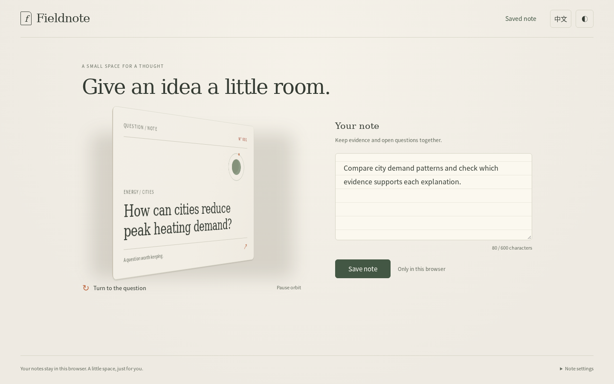 | 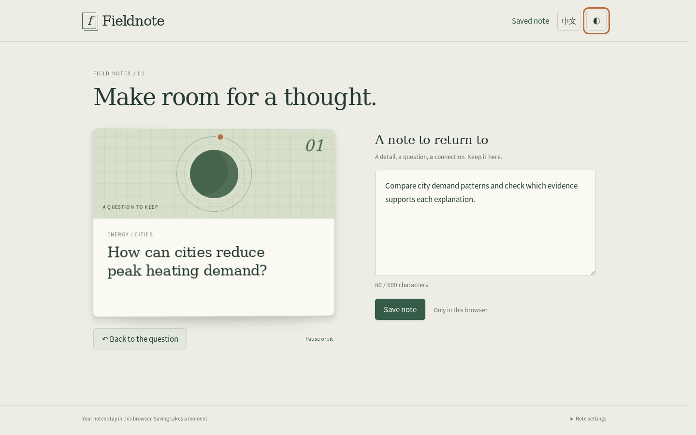 |  |

实际输入为点击翻面、约 45ms 后按 Shift+Tab。P8 与 L6 的状态记录显示焦点进入背面正文，此时图中仍显示正面，没有可见的正文焦点；N3 保持背面 inert，焦点回到右上角可见的主题按钮。截图略晚于状态采样，不能用来计算精确逐帧延迟；[原始轨迹](reviews/T2/checks.json)与[有限复核](reviews/T2/focus-followup.json)保留了观察依据和记录器修正。

[归档入口](reviews/T2/README.md)保留原稿、仅转换链接的阅读副本、失败记录及全部原始捕获。审阅者没有自然速度播放窗口或屏幕阅读器会话，因此静帧与状态轨迹不能证明翻转的流畅度或完整可访问性。这里保留 L6/P8 的原始早期焦点问题，不包含 C 条件后续独立修复的任何图片。

## T3｜已有表单的局部字号修正

以下两图均为 **390×844、中文、浅色、空字段**。STARTER 是原始产品；D5 代表修改后的产品。独立审阅先分别查看 D5、A9、K4，再确认三份产品文件集合及全部文件 SHA-256 一致，因此没有人为制造三组视觉排名。

| 修正前 · STARTER | 修正后 · D5（A9、K4 产品字节相同） |
|---|---|
|  |  |

[原始审阅](reviews/T3/review/review.md)确认占位文字由 15px 调整为 14px，并将原有 muted 颜色的不透明度调整为 1；输入文字保持 15px。指定语言、主题、视口与代表性保存恢复检查中，字段和操作区几何关系保持一致。[产品字节对照](reviews/T3/review/source-equality.json)与 [实际查看清单](reviews/T3/review/viewed-images.json)分别说明等价依据和观察范围。

[完整归档入口](reviews/T3/README.md)保留原始测量、唯一 CSS 变更、截图引起页面滚动的初次比较及修正解释。几何检查与颜色计算不等于完整无障碍认证；窄视口截图也不等于真机软键盘验证。

## 证据与保存边界

本页图像均来自独立 Agent 审阅，并在归档时再次打开核对。原始报告、脚本、测量、失败记录及全部保留证据具有逐文件 SHA-256；匿名产品源文件已与冻结运行快照逐一比对，未因审阅而修改。可重建的产品副本、依赖和缓存不重复归档。

每个补充 ZIP 均可独立解压，且小于 11,000,000 字节。完整材料的路径、摘要及产品身份核对记录见 [T1 归档索引](reviews/T1/archive-index.json)、[T2 归档索引](reviews/T2/archive-index.json)与 [T3 归档索引](reviews/T3/archive-index.json)。本画廊不构成人类验收、跨浏览器结论或方法普遍优越性的证明。
